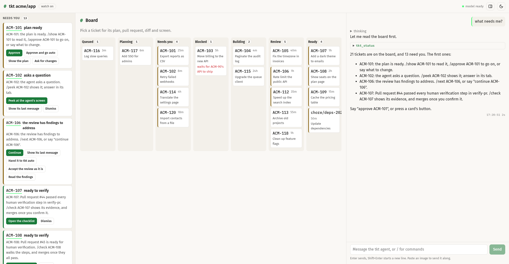
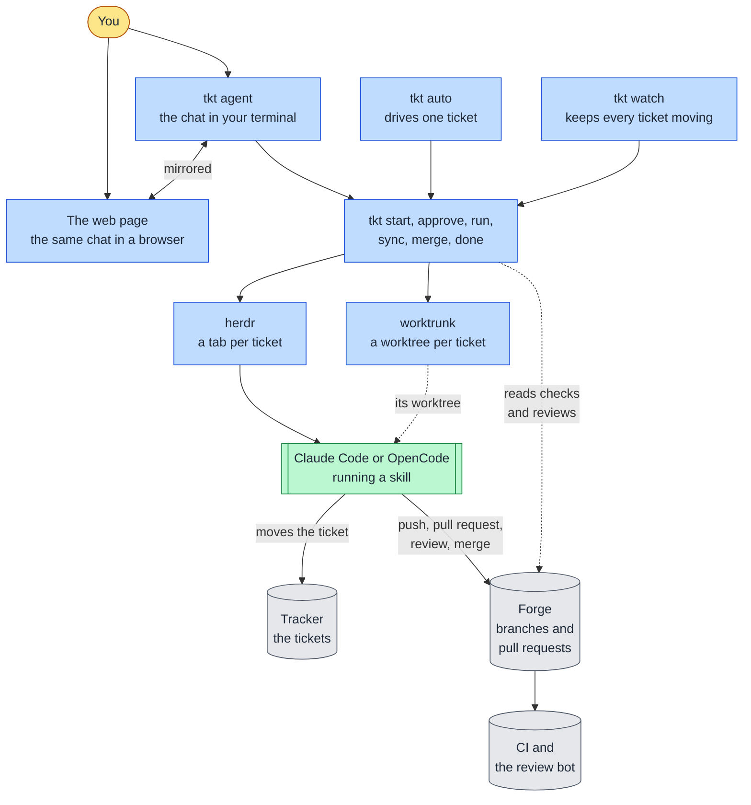
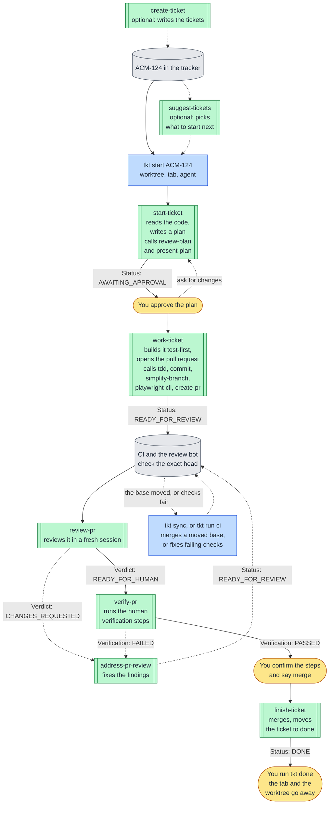
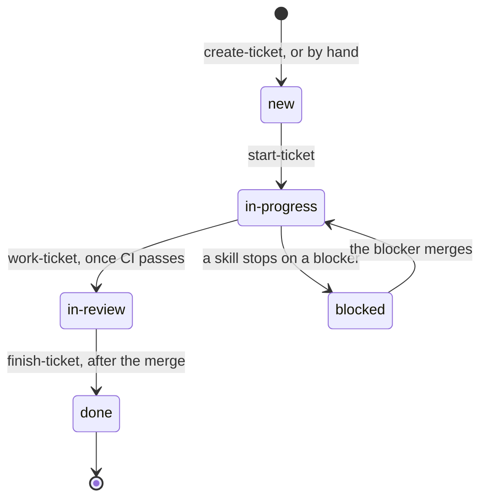
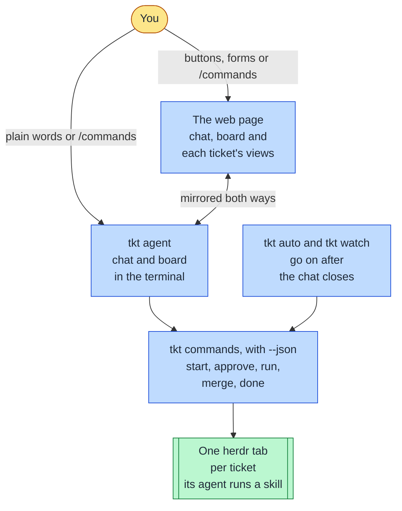
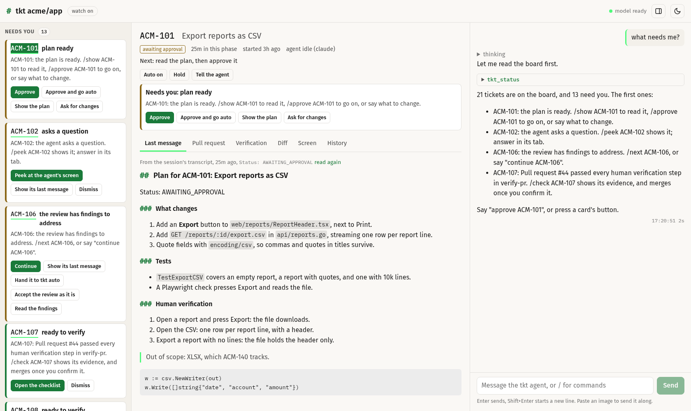
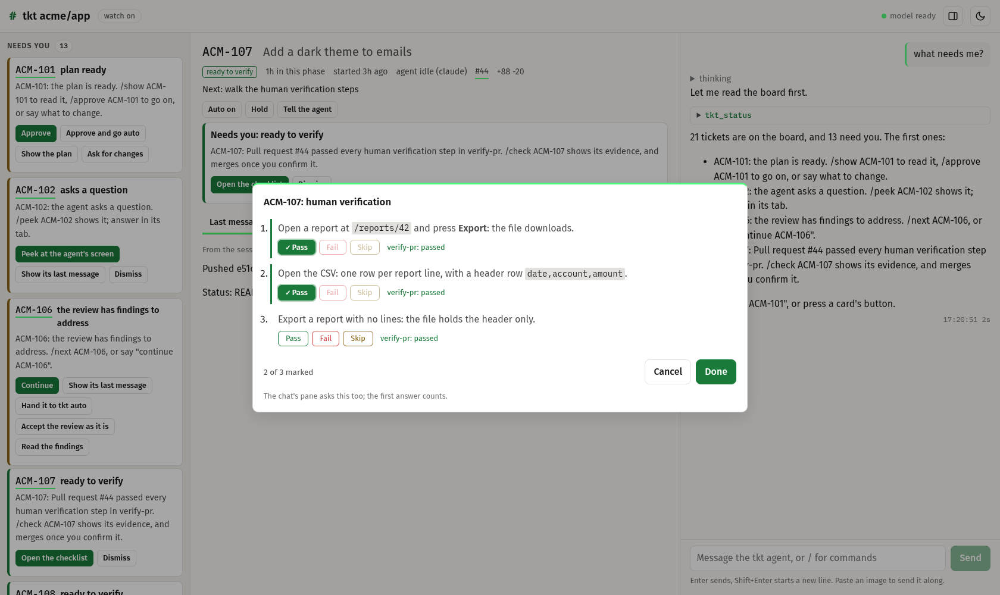
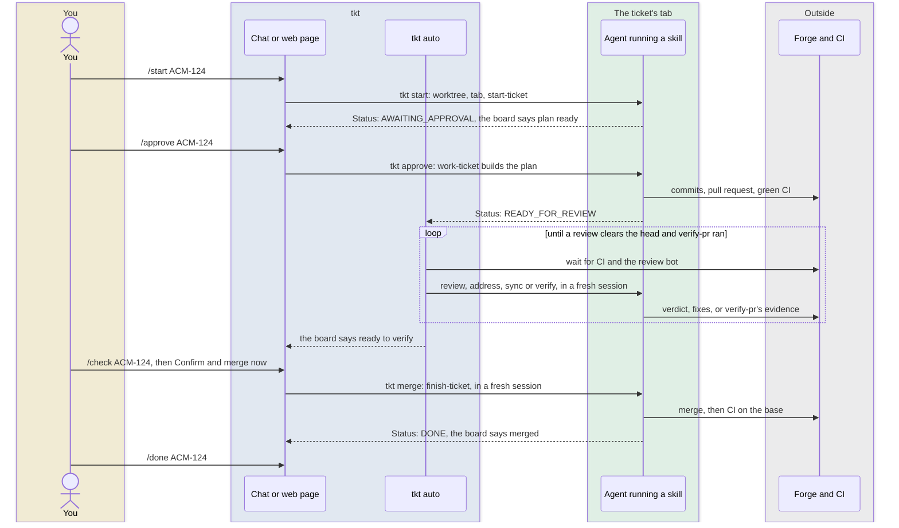

# tkt

`tkt` runs coding agents on your tickets, many at once. Each ticket gets its own git worktree, its own [herdr](https://herdr.dev) tab and its own agent, Claude Code or OpenCode. The agents follow the [rogs-skills](https://gitlab.com/rogs/skills) ticket lifecycle: one skill plans the ticket, one builds it, a fresh session reviews it, another runs its verification steps, and one merges it. tkt takes the mechanical steps between those stages. You decide at three points: the plan, the verification and the merge.

You drive it from a chat in your terminal, or from the same chat on a web page. Both show a board with every ticket and what needs you.



The first part of this page shows how it works. The second part is the reference.

- [How it works](#how-it-works)
- [A ticket from start to merge](#a-ticket-from-start-to-merge)
- [Two ways to drive it: the chat and the web page](#two-ways-to-drive-it-the-chat-and-the-web-page)
- [How much tkt drives](#how-much-tkt-drives)
- [Quick start](#quick-start)
- [Words used here](#words-used-here)
- Reference: [Install](#install), [Use](#use), [The tkt agent](#the-tkt-agent), [Settings](#settings), [Development](#development)

## How it works

The work splits in two.

- The skills do the thinking. Each lifecycle skill is one stage of a ticket: it plans, builds, reviews, verifies or merges. It ends with a status line, such as `Status: READY_FOR_REVIEW`, and it never starts the next skill.
- tkt does the mechanics between the stages. For each ticket it creates the worktree, opens a tab named after the ticket and its preset, such as `ACM-124 (claude)`, starts the agent there, and types the line that starts the stage. It reads the status lines, the pull request and CI to find each ticket's next step.



In the diagrams on this page, a rounded yellow box is you. A square blue box is tkt or a tool it runs. A green box with double sides is an agent running a skill. A grey cylinder is a service outside your machine.

The skills change the tracker and the forge. tkt never writes to the tracker, and it changes the forge in one way only: it pushes a clean merge of the base. People and programs both drive tkt: every command takes `--json`, every failure has a stable error code, and `tkt schema` describes the whole interface.

## A ticket from start to merge

A ticket moves through the same stages every time. Each arrow out of a stage is a status line or a verdict; each arrow into a stage is a step that you, `tkt auto` or `tkt watch` takes.



Solid arrows are the path a ticket takes when nothing goes wrong. Dotted arrows are optional steps and the loops: a review with findings, a failed verification step, a moved base or failing checks each send the ticket back, and the new head gets a new review.

| Skill | What it does | Ends with | Calls |
|---|---|---|---|
| `setup-rogs` | Runs once per repository. It asks about the tracker, the forge, CI and the optional features, and writes `docs/agents/*.md`, which every other skill reads. | `Status: CONFIGURED` | `writing-for-agents`, `commit` |
| `create-ticket` | Audits the code and the tracker, drafts tickets, and creates them once you approve a preview. | `Status: AWAITING_CREATE_APPROVAL`, then `Status: TICKETS_CREATED` | |
| `suggest-tickets` | Picks ready tickets that can run side by side, ranked by what each one unblocks. It changes nothing. | `Status: TICKETS_SUGGESTED` | |
| `start-ticket` | Moves the ticket to in-progress, reads the code end to end, and writes a plan. It writes no code. | `Status: AWAITING_APPROVAL`, or `Status: PLAN_APPROVED` once you approve in the browser | `review-plan`, `present-plan`, `asd-ste100` |
| `work-ticket` | Builds the plan in the same session: commits, the pull request, green CI on the exact head, and a handoff comment on the ticket. | `Status: READY_FOR_REVIEW` | `tdd`, `diagnosing-bugs`, `commit`, `simplify-branch`, `playwright-cli`, `create-pr` |
| `review-pr` | Reviews the pull request at its exact head, in a session that did not write it, and posts its findings with a verdict. It never edits code. | `Verdict: CHANGES_REQUESTED` or `Verdict: READY_FOR_HUMAN` | |
| `address-pr-review` | Merges the base, fixes each valid finding at its root cause, answers the rest with evidence, and replies to every comment. At most two rounds. | `Status: READY_FOR_REVIEW` | `tdd`, `diagnosing-bugs`, `commit` |
| `verify-pr` | Runs the human verification steps the way you would, in a browser or with the step's commands, and posts what it saw on each step. It never edits code. | `Verification: PASSED`, `FAILED` or `INCOMPLETE` | `playwright-cli` |
| `finish-ticket` | Merges on your word, checks the merge, moves the ticket to done, and names the tickets the merge unblocked. | `Status: DONE` | |

Every skill can also stop with `Status: BLOCKED` and a reason, or with `Status: SETUP_REQUIRED` when the repository has no configuration. Four rules hold the stages together:

- The agent that wrote a change never reviews it. Every review runs in a fresh session.
- Every claim names the exact commit it holds for: CI passed on this head, the review cleared this head. A new push needs a new review.
- Only finish-ticket merges, and only on your word, or in a yolo run you started.
- Branches take the base by merging it. Nothing rebases or force-pushes.

The tracker's board follows the ticket, since each skill moves it the moment its new state is true:



review-pr and verify-pr never write to the tracker, and tkt never touches it.

## Two ways to drive it: the chat and the web page

In a herdr pane inside the repository, type `tkt`. It opens the tkt agent: a chat about the repository's tickets, with a board pinned on top. Say what you want in plain words, such as "start ACM-124" or "what needs me?", or type a slash command, such as `/approve ACM-124`. Type `/web`, and the same chat opens in your browser, beside the board. What you type in either place shows in both, and you can answer a question the chat asks in either one; the first answer counts. Every button on the page sends the slash command you could type, so the two never drift.



The chat only runs tkt. It cannot read code, run a shell or browse: each ticket's own agent does the work, in its own tab. The `tkt auto` loops and `tkt watch` run on their own, so closing the chat stops nothing.

In the terminal, the board pinned above the chat lists every ticket, then what needs you, each item with the command that acts on it:

```
tkt  app  8 tickets  5 need you  watch on
TICKET    AGE  PHASE             TIME AGENT    PR     DIFF        NOTES
ACM-101   3h   awaiting approval 25m  idle     -      -           Export reports as CSV
ACM-106   3h   needs fix         1h   idle     #43    +140 -9     Rate limit the public API
ACM-107   3h   ready to verify   1h   idle     #44    +88 -20     Add a dark theme to emails
ACM-109   3h   ready to merge    15m  idle     #46    +64 -18     Cache the pricing table
ACM-110   3h   merged            20m  idle     #38    +12 -410    Drop the legacy login page
ACM-104   3h   working           4m   waiting  #41    +293 -41    auto  Paginate the audit log
ACM-116   3m   queued            3m   -        -      -           queued  Log slow queries
ACM-117   6m   planning          6m   working  -      -           Add SSO for admins

! ACM-101 plan ready   /show ACM-101, /approve ACM-101
! ACM-106 the review has findings to address   /next ACM-106
! ACM-107 ready to verify   /check ACM-107
! ACM-109 ready to merge   /check ACM-109
! ACM-110 merged   /done ACM-110
/board  /inbox  /board hide
```

On the web page, the same items are cards with their answers as buttons. Pick a ticket, and the middle column shows it with six tabs: its last message, such as the plan, the pull request with its checks and reviews, the human verification steps, the diff, the agent's live screen, and its history.





One ticket in auto, the default mode, from the first look to the cleanup:

| Step | In the chat | On the web page | What runs |
|---|---|---|---|
| Pick what to start | "what should I work on next?", or `/suggest 3` | Suggest, in the left column | suggest-tickets, in a suggest tab at the repository's root |
| Start it | `/start ACM-124`; with more than one preset, the chat asks which | Start tickets, or Start it on a card for a ticket a merge unblocked | `tkt start`: the worktree, the tab, the agent and start-ticket. A `tkt auto` loop waits for your approval. |
| Read the plan | `/show ACM-124` | Pick the ticket: its Last message tab draws the plan | |
| Approve it, or ask for changes | `/approve ACM-124`, or "tell ACM-124 to keep the old field" | Approve, or Ask for changes | `tkt approve` or `tkt send`. work-ticket builds in the same session. |
| Let it run | The board shows each phase, and herdr notifies you when a ticket needs you | The board's columns, and the Pull request, Diff and Screen tabs | `tkt auto` waits for CI and the review bot, and runs review-pr, address-pr-review, `tkt sync` and then verify-pr, each in a fresh session |
| Answer what needs you | `/inbox`, or `/peek ACM-124` to see the agent's screen | The cards under Needs you | |
| Verify | `/check ACM-124`: confirm from verify-pr's evidence, or walk the checklist | Open the checklist, or the Verification tab | `tkt verified` comments on the pull request that the steps passed |
| Merge | `/check` ends with Confirm and merge now, or Merge now | Merge it | `tkt merge`: finish-ticket merges in a fresh session |
| Clean up | `/done ACM-124` | Remove it | `tkt done` closes the tab, removes the worktree and names the tickets the merge unblocked |

The same ticket, in time:



## How much tkt drives

You pick a mode when you start a ticket. The default, auto, leaves you the three decisions and takes every step between them.

| Mode | The plan | Review and fixes | Verification | The merge | Start it with |
|---|---|---|---|---|---|
| manual | You approve it | You run each stage | You, or verify-pr when you run it | You say merge | `/start ACM-124 manual`, `tkt start ACM-124 --manual` |
| auto, the default | You approve it | `tkt auto` | verify-pr runs the steps, you confirm them | You say merge | `/start ACM-124`, `tkt start ACM-124` |
| auto-plan | `tkt auto` approves it | `tkt auto` | verify-pr runs the steps, you confirm them | You say merge | `/start ACM-124 auto-plan`, `tkt start ACM-124 --auto-plan` |
| yolo | A model from another vendor reviews it, `tkt auto` approves it | `tkt auto` | verify-pr alone | finish-ticket merges once verify-pr passed every step | `/start ACM-124 yolo`, `tkt start ACM-124 --yolo` |

On the web page, the Start tickets form has the same four choices. `/auto ACM-124 on` or `off` hands a ticket you started to `tkt auto`, or takes it back. In every mode, `tkt done` stays yours. Yolo runs only where the repository turns it on, and has rules of its own: see [Yolo](#yolo).

Three things move a ticket:

- You: approve plans, answer the agents' questions, confirm the human verification steps, say merge, and run `tkt done`.
- `tkt auto ACM-124`, one loop per ticket: it takes every step a ticket in auto needs, and pauses where a person decides, such as when an agent asks a question or after five fix rounds. It goes on by itself once you act.
- `tkt watch`, one per repository, which tkt commands start by themselves: every minute it merges a moved base when a sync is due, fixes failing checks once per head, removes a ticket whose pull request closed without merging, carries out the merge orders you left, and starts the chores you schedule. It never removes a merged ticket. While a service it depends on reports an incident, it starts no agent, and neither does `tkt auto`. A sync whose turn to push has not come, because other syncs hold every push slot or memory is short, waits for a later pass, so a pass never blocks the other tickets; `tkt ls` and the board say what it waits for.

`tkt ls` shows the next step for every ticket, so you can drive one by hand at any time. [`docs/lifecycle.md`](docs/lifecycle.md) follows a ticket through every loop in depth, and [`docs/day-in-the-life.md`](docs/day-in-the-life.md) follows a whole working day with several tickets in flight.

## Quick start

1. Install tkt (see [Install](#install)) and the skills:

   ```bash
   npx skills add https://gitlab.com/rogs/skills.git
   ```

2. In the repository, run `/setup-rogs` in Claude Code, or `@setup-rogs` in OpenCode. It asks about the tracker, the forge, CI and the optional features, and writes `docs/agents/*.md`. Commit those files to the base branch: ticket worktrees branch from it.
3. In a terminal in the repository, check the setup and install the hooks that tell tkt what each agent does:

   ```bash
   tkt doctor
   tkt hook claude --install   # for Claude Code
   tkt hook tmp --install      # for OpenCode
   tkt watch --install         # optional: tkt watch and herdr's server start at boot
   ```

4. In a herdr pane in the repository, type `tkt`. The first time, sign in to a model provider with `/login`. Type `/web` to open the web page.
5. Say "start ACM-124", and follow the table in [Two ways to drive it](#two-ways-to-drive-it-the-chat-and-the-web-page).

## Words used here

| Word | Meaning |
|---|---|
| Ticket | A piece of work in the tracker, such as `ACM-124`. One ticket gets one branch, one worktree and one tab, all named after it. |
| Base | The branch a ticket's branch starts from and merges into, such as `main`. |
| Head | The newest commit on the ticket's branch. CI results, reviews and verification count only for the head they name. |
| Worktree | Another checkout of the repository in a directory of its own, so tickets never share files. worktrunk creates and removes them. |
| Tab | The herdr tab where the ticket's agent runs, such as `ACM-124 (claude, auto)`. |
| Harness | The program that runs the agent: Claude Code or OpenCode. |
| Preset | A harness and a model under one name, such as `claude` or `fast`, set in `config.toml`. |
| Skill | Instructions an agent loads for one job. The lifecycle skills are the stages; the others help them. |
| Stage | One skill's run on a ticket, started by a line tkt types, such as `review` or `verify`. |
| Status line | The line a skill ends with, such as `Status: READY_FOR_REVIEW`. tkt reads it to find the next step. |
| Verdict | review-pr's result for a head: `CHANGES_REQUESTED` or `READY_FOR_HUMAN`. |
| Human verification steps | The numbered steps in the pull request that show the change works. You run them, or verify-pr runs them and you confirm. |
| Merge order | What `tkt merge` leaves when finish-ticket cannot merge yet. `tkt watch` carries it out. |
| Chore | An agent run you schedule, such as a weekly dependency upgrade. It opens a pull request but has no ticket. |

## Install

On Linux or macOS, the install script downloads the latest release, checks it against the release's `SHA256SUMS` and installs it to `~/.local/bin`:

```bash
curl -fsSL https://git.rogs.me/rogs/tkt/releases/download/latest/install.sh | sh
```

`sh -s -- --dir DIR --version vX.Y.Z` picks another directory or release. The checksum catches a broken download, not a compromised host.

To download the binary yourself (this works in fish, bash and zsh; replace `linux_amd64` with `linux_arm64`, `darwin_amd64` or `darwin_arm64` for other systems):

```bash
mkdir -p ~/.local/bin && curl -fsSLo ~/.local/bin/tkt https://git.rogs.me/rogs/tkt/releases/download/latest/tkt_linux_amd64 && chmod +x ~/.local/bin/tkt
```

With Go 1.26 or newer (this build lacks the pi that `tkt agent` runs; see [The tkt agent](#the-tkt-agent)):

```bash
go install gitlab.com/rogs/tkt@latest
```

To update an installed tkt to the latest release, run `tkt update`. It makes the same checksum check as the install script, runs the new binary once, and only then replaces the old one. Running `tkt auto` loops and `tkt watch` move to the new tkt by themselves. `tkt update --check` reports without changing anything, and `tkt update vX.Y.Z` installs a given release, prereleases included. A development build, whose `tkt --version` prints `dev` or a `dev-` version, has no release to compare, so `tkt update` replaces it only with `--force`.

### Requirements

- git 2.38 or newer;
- herdr 0.9.3 or newer, with tkt running inside a herdr pane;
- [worktrunk](https://worktrunk.dev) (`wt`) 0.68 or newer;
- Claude Code or OpenCode;
- the configuration that the `/setup-rogs` skill writes into the project;
- `gh` for `tkt done`, `tkt watch` and the pull request columns of `tkt ls`, which support GitHub forges only.

`tkt doctor` checks all of these.

worktrunk must name each worktree directory after its branch. Put the setup an agent needs, such as copying `.env` files and dependencies, in a `pre-start` hook. worktrunk runs `post-start` hooks in the background, so an agent could start before they finish:

```toml
worktree-path = "~/code/worktrees/{{ repo }}/{{ branch | sanitize_hash }}"

[pre-start]
copy = "wt step copy-ignored"
```

### Shell completion

Completion offers ticket ids, stages, presets and panes:

```bash
tkt completion fish > ~/.config/fish/completions/tkt.fish
```

`tkt completion bash` and `tkt completion zsh` work the same way.

## Use

| Command | What it does |
|---|---|
| `tkt agent` | Opens the tkt agent, a chat in your pane that drives your tickets. |
| `tkt web` | Opens the tkt agent's web page in your browser: the same chat, mirrored both ways. It opens `tkt agent` in a new tab when no chat runs. |
| `tkt suggest [N \| REQUEST]` | Has suggest-tickets pick the next tickets to start, in a suggest tab at the repository's root: the ones a request asks for, such as `tkt suggest five tickets tagged feedback`, or N tickets that can run side by side, 3 by default. The picks stay in that tab, for you to read and start; `tkt suggest --show` prints them again. |
| `tkt start [ID]` | Creates the worktree and tab, starts an agent and sends it the prompt, then starts `tkt auto`, which takes over once you approve the plan. `--manual` starts no loop, and `--auto-plan` and `--yolo` start the loop that approves the plan too. |
| `tkt approve ID` | Approves the plan in the ticket's own session, so work-ticket begins there. |
| `tkt send ID TEXT` | Types text into the ticket's running session, such as changes to the plan; `--steer` types it in while the agent works, and `--wait` queues it until the agent stops. |
| `tkt auto ID` | Drives the ticket: approves the plan with `--auto-plan`, waits for CI and the review bot, runs the fixes, runs verify-pr where agent verification is on, pauses when the ticket needs you, and stops when the head is reviewed clean and verified. `--yolo` carries it to the merge with nobody watching (see [Yolo](#yolo)). |
| `tkt hold ID` | Puts the ticket on hold, so `tkt watch` and `tkt auto` leave it alone; `--off` takes it off hold. |
| `tkt incidents` | Lists what the status pages report. `--ignore` lets `tkt watch` and `tkt auto` start agents through the incidents reported now, until each ends; `--off` holds them back again. |
| `tkt watch` | Keeps every ticket moving: syncs a moved base, runs ci once per head when the checks fail, and removes a ticket whose pull request closed without merging. tkt commands start it by themselves; `--install` runs it, and herdr's server, as services that start at boot. |
| `tkt run ID STAGE` | Replaces the ticket's idle agent with a fresh session and sends a stage line: `review`, `address` (which merges the base first), `resolve`, `ci`, `verify` (verify-pr runs the human verification steps and posts what it saw) or `start`. `sync`, the old name of `address`, still works and warns. |
| `tkt sync ID` | Merges the base into the ticket's branch: itself, with no agent, when the merge is clean; through a fresh session in a split beside the ticket's agent on a conflict, or when the sync fails another way, such as on a push a pre-push hook refuses. The merge and push run the repository's hooks, so at most `[sync] pushes` syncs (2) on the machine push at once, each once `[sync] min_free` of memory (20%) is free; a sync waits for its turn and says on what. A sync killed during its push leaves its merge behind, and the next one drops that merge and merges again. |
| `tkt accept ID --reason TEXT` | Takes the review at the head as it is, when its findings do not matter: it comments `## Review accepted` on the pull request, which finish-ticket and verify-pr take in place of a clean review, and the head goes on to human verification with the steps from the pull request's body. The acceptance holds across clean merges of the base; a fix voids it. |
| `tkt verified ID --passed STEPS` | Comments on the pull request that every human verification step passed on a head, once per head. `--waived STEPS --reason TEXT` names the steps you skipped instead, and why. `/check` in the tkt agent runs it before it asks whether to merge. Until you merge, the ticket shows as ready to merge, with the merge as its next step. |
| `tkt merge ID --passed STEPS` | Once the human verification steps passed, sends finish-ticket the word to merge in a fresh session, naming the head they passed on. When finish-ticket could not merge yet, leaves a merge order that `tkt watch` carries out: it syncs a clean base, has the new head reviewed, waits for green checks, and merges one ticket at a time. The steps carry over clean merges of the base, so a verified batch merges while you are away. `--evidence` says you confirmed the steps from verify-pr's evidence. |
| `tkt resume ID` | Relaunches the ticket's newest session when no agent runs for it, and sends nothing. |
| `tkt done ID...` | Closes the tabs of tickets whose pull request merged, or closed without merging, and removes their worktrees. It names the tickets each merge unblocked, which `tkt ls` lists and the tkt agent offers to start. `--all` checks every ticket worktree. |
| `tkt drop ID` | Throws away a ticket you started by mistake, merged or not: closes its tabs and agents, ends its `tkt auto` loop, and removes its worktree with any uncommitted changes, its branch and its temporary directory. On GitHub it also closes your open pull request and deletes the branch from the remote, but only when every commit on that branch has your git email. It lists what goes and asks you to type the ticket id first; `--yes` skips the question, and `--dry-run` only lists. It refuses a merged ticket, which `tkt done` removes, and never writes the tracker. |
| `tkt chores` | Lists the repository's chores, the agent runs you schedule in its `.tkt/tkt.local.toml`, with their next run and the run still open; `--json` adds each chore's prompt. |
| `tkt chore run NAME` | Starts a run of a chore now: a branch from the fetched base, its worktree and tab, and an agent with the chore's prompt. |
| `tkt ls [ID...]` | Lists ticket worktrees with their agent, pull request, checks, review and the next step. |
| `tkt show ID` | Prints the agent's last message, such as the plan; `--screen` its live screen, with `--ansi` in color; `--steps` the human verification steps, with what verify-pr saw on each one, and the setup and cleanup around them; `--diff` what the branch changes since it left its base. |
| `tkt wait ID` | Blocks until the ticket's agent needs you or has finished. |
| `tkt presets` | Lists the presets `--as` takes in this repository, in order, with the default first. |
| `tkt stats` | Shows how long tickets took from start to merge, and how long they waited for you. |
| `tkt history ID...` | Shows what happened to tickets, merged ones too: each event with its time, and the pull request's commits and reviews. |
| `tkt doctor` | Checks the tools, versions and configuration tkt needs. |
| `tkt hook tmp --install` | Installs tkt's OpenCode plugin, which gives OpenCode agents their ticket's `TMPDIR`, moves the new `/tmp` paths they type into it, and tells tkt each prompt, status line and skill start. |
| `tkt hook claude --install` | Adds tkt's Claude Code hooks to the project's `.claude/settings.local.json`, or `settings.json` with `--shared`: they tell tkt each prompt, each turn's status lines and each skill start, so a plan approved in the viewer shows at once. `tkt doctor` checks for them. |
| `tkt schema` | Describes every command, flag, result and error code as JSON. |

From a terminal alone, without the chat, a ticket goes like this:

1. Run `tkt start ACM-12`, or pipe in the dispatcher's block with `tkt start --prompt -`.
2. Read the plan with `tkt show ACM-12`, then `tkt approve ACM-12`.
3. When the agent reports `Status: READY_FOR_REVIEW`, run `tkt run ACM-12 review`.
4. Act on the verdict with `address`, or on a moved base with `tkt sync ACM-12`, and review again.
5. Verify: run the steps yourself, or have `tkt run ACM-12 verify` run them and confirm from verify-pr's evidence. Then `tkt merge ACM-12 --passed all`, with `--evidence` in the second case: finish-ticket merges, and the ticket stays until you run `tkt done`.

### Agent verification

Where `docs/agents/workflow.md` turns on `Agent verification` (`/setup-rogs` asks), verify-pr runs the human verification steps once a review clears the head. It works in a fresh session, as you would: in a browser for a page, with the step's own commands otherwise. It posts what it saw on each step as a review on the pull request, with captures, and changes no code. `tkt auto` runs it for you. A step it reports failed goes back to `address`, then a new review and a new run; steps it could not run, such as one that needs a real phone, stay for you. When every step passed, `/check` in the tkt agent lists what it saw and merges once you confirm, and `tkt merge ID --passed all --evidence` does the same from the terminal. A `[verify] as` preset runs verify-pr on another model, such as another vendor's, so it does not share the blind spots of the one that built the change.

### Yolo

`tkt auto ACM-12 --yolo` carries a ticket from start to merge with nobody watching. Agents plan it, build it, review it, verify it and merge it; no person checks anything before it merges. It runs only where `docs/agents/workflow.md` turns on `Autonomous runs`, `Agent verification` and `Plan review`, and refuses with `autonomous_off` elsewhere.

- Every line its agents get says "This run is autonomous". The skills then decide what they would ask you, on the most conservative reading, and write each decision under `## Assumptions` in the plan and the pull request. Read those afterwards.
- A model from another vendor reviews the plan in place of you, and tkt approves it.
- At a hard stop that workflow.md lists, such as a migration or anything about payments, the ticket goes to `blocked` with a comment, and the loop pauses for you.
- review-pr reviews every head, even one the review bot cleared, since finish-ticket merges on its verdict, unless workflow.md turns `CI review` on: then the bot's `CLEAR` is that verdict. Then verify-pr runs, and once it passed every step, finish-ticket merges with every other gate still in place: green CI at the exact head, the review at the same head and base, no open feedback.
- One merge goes at a time in the repository. When the checks on the base fail after the merge, the loop stops and notifies you, and nothing else happens.
- A base branch whose protection requires a person's approval cannot merge this way.

A yolo run starts with the ticket: `--yolo` refuses a ticket you started another way, since finish-ticket merges only where start-ticket recorded the yolo start. The ticket stays a yolo one until `tkt auto ACM-12 --stop`, which also drops a merge order the loop left. Start with a repository where a wrong merge costs little.

For work with no ticket, `tkt start --scratch spike-login` makes the worktree, branch and tab `spike-login` and starts the agent without sending it anything. The other commands work on tickets and chore runs only, so remove that worktree with `wt remove spike-login`.

### Chores

A chore is an agent run you schedule, such as a dependency upgrade. tkt ships none: each one is a table in the repository's `.tkt/tkt.local.toml`, your own file there (see [Settings](#settings)):

```toml
[chores.deps]
schedule = "0 9 * * 1,4"   # cron's five fields, in local time
branch = "deps-{date}"
as = "fast"
prompt = "Upgrade the dependencies. Read each migration guide, and note the breaking changes in the pull request."
```

That repository's `tkt watch` starts a run when its slot comes: a branch from the base on the remote, its own worktree and tab, and an agent with the prompt and one rule, which says to open one pull request and end with `Status: READY_FOR_REVIEW`, or with `Status: DONE` when there is nothing to change. The run's id is its branch, such as `deps-2026-10-26`, and `tkt ls`, `tkt run`, `tkt sync`, `tkt done` and the board take it like a ticket's. `tkt watch` syncs its base and fixes its checks; no skill reviews or merges a pull request without a ticket, so you merge it yourself and run `tkt done`, or close it to drop the run, and `tkt watch` then removes the run. A chore whose work lands elsewhere, such as a tag and a release, sets `pr = false`: its agent opens no pull request, commits nothing on the run's branch, and ends with `Status: DONE`, and `tkt watch` removes the run at once. A slot that comes while the last run is still open is skipped, and a slot missed while no watch ran runs once when one runs again. `tkt help chores` has the details. A chore that needs no agent, such as `npx skills update`, belongs in a plain systemd timer or cron job.

### The tkt agent

`tkt agent` opens a chat in your pane about the repository's tickets. Typing `tkt` alone opens it too, at a terminal in a herdr pane inside a configured repository; anywhere else, `tkt` alone prints help. [`docs/day-in-the-life.md`](docs/day-in-the-life.md) follows one working day in the chat, and shows when to use it and when the terminal does better.

The chat runs [pi](https://github.com/earendil-works/pi), an MIT-licensed coding agent. Release builds of tkt carry pi inside them and unpack it on first use under `~/.local/share/tkt/pi`. A tkt built with `go install` has no pi inside; set `TKT_PI` to a pi binary to use one.

The chat stays apart from any pi you run yourself. It loads only tkt's own extension, and none of your pi extensions, skills, prompt templates or themes, nor the project's `AGENTS.md` or `CLAUDE.md`. It keeps its settings, logins and sessions in `~/.config/tkt/pi`, so log in to a model provider once with `/login` inside the chat. `tkt agent --continue` picks up the last chat about the repository, and `tkt agent --session ID` the one whose id the chat printed when you quit. Flags after `--` go to pi as they are, such as `tkt agent -- --thinking high`.

The chat brings its own themes, `tkt-dark` and `tkt-light`, and picks the one that suits the terminal. Under a dark theme in fullscreen mode, the chat paints its own dark background, so a transparent terminal does not show through. Overlays such as `/board` and `/peek` draw on a panel of their own, so they read well on a transparent terminal. A theme you pick in `/settings` wins from then on. The chat leaves the mouse to your terminal, so selecting and copying text works as in any other program; PageUp and PageDown scroll the chat.

Say what you want in plain words, such as "start ACM-12", "run ACM-13 to ACM-15 in auto with sol", "I approved the plan for ACM-12, continue" or "ACM-12 is merged, remove it". Starting tickets and stages runs in the background and the prompt comes back at once, so you can start the next ticket while the first one plans. A board pinned to the top of the chat shows every ticket with its age since `tkt start`, its time in the current phase, what its branch changes, such as `+293 -8`, and its pull request's title, and on top what needs you: a plan to approve, a question from its agent, a pull request ready for human verification, or a `tkt auto` loop that paused for you. The chat scrolls below it. An item leaves the board as soon as its ticket moves on, so the chat stays clean; each new one also shows a herdr notification. Tickets in auto run in `tkt auto` loops that outlive the chat, and a loop that paused for you goes on by itself once you act. Text you send a working agent goes in at once, and the agent reads it at its next step. Each prompt shows the time it reached the model, and each answer the time it was done and how long it took.

Ask how a ticket went, merged ones too, such as "how did ACM-12 go?" or "what failed in ACM-12 and ACM-13?". The chat reads `tkt history`: each step with its time, and the pull request's commits and reviews with the review bot's findings.

| Command | What it does |
|---|---|
| `/suggest [N \| REQUEST] [as PRESET]` | Does what `tkt suggest` does; `/suggest` alone asks you to type the request. You read the picks in the suggest tab, or in the web page's Suggest view, and `/start` the ones you want. |
| `/start ID... [auto \| auto-plan \| manual \| yolo] [as PRESET]` | Starts tickets, on the preset you name; without one, the chat asks which, wherever the start came from, such as `/inbox` or a card on the web page. It starts in auto by default, where tkt auto takes over once you approve the plan; in auto-plan, which approves the plan too; or manual. `yolo` asks once, then carries them to the merge with nobody watching; so does "start ACM-12 in yolo". |
| `/approve ID [auto]` | Approves the plan; with `auto`, `tkt auto` takes over. |
| `/next ID` | Takes the ticket's next step, as `tkt auto` would. |
| `/auto ID on \| off \| full \| yolo` | Turns `tkt auto` on or off for a ticket; `yolo` asks once, then carries it to the merge with nobody watching. |
| `/sync ID` | Merges the base into a ticket's branch, as `tkt sync` does. `/check` offers it first when the ticket is behind its base; your steps carry over a clean sync either way. |
| `/hold ID [off]` | Puts a ticket on hold, so `tkt watch` and `tkt auto` leave it alone, or takes it off hold. |
| `/incidents [ignore \| off]` | Does what `tkt incidents` does. The web page's incident banner sends `/incidents ignore` from its Start agents anyway button. |
| `/send ID TEXT`, `/show ID`, `/peek ID` | Talks to the ticket's agent, prints its last message, or watches its live screen. |
| `/run ID STAGE [as PRESET]`, `/relaunch ID` | Runs a stage, such as `review` or `verify`, in a fresh session, as `tkt run` does; relaunches the newest session when no agent runs, as `tkt resume` does. |
| `/accept ID [REASON]` | Accepts the review at the head as it is, as `tkt accept` does, and asks for the reason when you give none. The board and the web page offer it on a ticket whose review has findings. |
| `/check ID` | Walks the human verification steps as a checklist, and starts a fix session for a step that failed. When you skip a step, it offers to post that human verification passed with the skipped steps and your reason, so finish-ticket takes them as waived. When verify-pr passed every step, it offers to confirm them from its evidence instead, and its checklist starts with the steps verify-pr passed. Once every step passed, it merges with `tkt merge`: now, or with a merge order that `tkt watch` carries out once the head is synced, reviewed and green. On a ticket ready to merge, whose steps passed before, it asks only whether to merge. |
| `/inbox`, `/board`, `/stats` | What needs you, with fixed answers; every ticket in columns (`/board hide` and `/board show` put the pinned board away and back); how long tickets take. |
| `/dismiss ID` | Sets aside what a ticket needs from you, until its situation changes, as `/inbox`'s Dismiss does. |
| `/chores [run NAME]` | The repository's chores with their next run; `run NAME` starts a run now. |
| `/history ID...` | What happened to tickets: each event, commit and review. |
| `/done ID` | Removes a merged ticket. |
| `/drop ID` | Throws away a ticket started by mistake, as `tkt drop` does, once you type its id. The web page has a red Drop button at the end of a ticket's buttons that sends it. |
| `/version` | Says which tkt and pi the chat runs, and whether the tkt on disk is another one now. |
| `/update` | Installs a newer tkt, then offers to quit. Reopen the chat with the `tkt agent --session ID` it prints to run the new tkt. The board names a newer release when the chat finds one. |
| `/web` | Opens the chat's web page in your browser, as `tkt web` does, unless a browser here has it open. `/web new` opens another tab anyway. |

Without an `[agent]` model, pi starts on its own default: in `/model`, press Ctrl+S on a model to make it the default for new chats. An `[agent]` table in `config.toml` picks the model and loads more pi extensions, such as one that adds a model provider:

```toml
[agent]
model = "acme/large"
extensions = ["~/.pi/agent/extensions/acme-provider.ts"]
```

#### The web page

`tkt web`, or `/web` in the chat, opens the same chat in your browser, with the board beside it. The page has three columns:

- On the left, what needs you, as cards with the answers `/inbox` offers as buttons, such as Approve or Open the checklist; then every ticket with its phase, ages, diff size and pull request title; then links to the suggest, chores, stats and version views. The suggest view sends `/suggest` and shows suggest-tickets' answer as it comes; its Any model choice asks for tickets on any model, with no cap on heavy tickets, so suggest-tickets does not stop to ask. The chores view gives each chore a card with its schedule, runs and a Run now button, and folds its prompt under it.
- In the middle, the ticket you picked, with buttons for what its state allows and six tabs: the agent's last message, such as the plan, drawn as a page; the pull request with its checks, what the newest review found and verify-pr's report; the human verification steps, with your marks and verify-pr's; the diff, file by file; the agent's live screen in color, read again every second, with a box that tells the agent something; and the history. With no ticket picked, it shows the board in its columns, or the view you picked.
- On the right, the chat itself, mirrored both ways: a message you send in either place shows in both, with the model's answer as it streams in, its tool calls and the times. The panel button at the top hides it to give the ticket more room, and shows it again; each browser keeps its own choice.

Every button sends the slash command you could type, through the chat, so the terminal shows what it did and the two never drift. The button you press spins and takes no second press until tkt answers or, when the command starts a job such as a sync, until that job ends. The answer's first sentence, such as `Queued: tkt sync for ACM-12.`, shows as a notice beside the chat; the chat holds the whole answer, and the notice shows it on hover. A background job, such as that sync, gives another notice when it ends: `ACM-12: merged its base and pushed abc1234.`, in the terminal too. The forms for starting tickets and for suggest-tickets show the command before you send it. A question the chat asks, such as "Remove ACM-12?", `/check`'s "how do you want to verify?" or its checklist, shows in both places, and the first answer wins and closes the other. Slash commands work in the page, which offers them as you type `/`, and you can paste an image into a message. `/peek ID` and `/board` typed in the page open its own views, as they open overlays in the terminal. pi's own screens, such as `/model`, `/login` and `/resume`, open in the terminal only. The page's title counts the tickets that need you and the questions that wait, and each new item gets a notice in the page.

The chat serves the page itself, so it lives as long as the chat does. It listens on every address, so a phone or another computer on your network can open it too: `/web` prints the page's address on each of this machine's network addresses, token and all, beside the one it opens. Anyone on the network who sees that address drives the chat, and the page uses plain HTTP, so open it only on a network you trust. The first chat in a repository serves it; a second one says it serves none, and takes the page over once the first quits, so the open pages come back to it. When no chat serves the page, `tkt web` opens `tkt agent` in a new tab of the herdr workspace and waits for it. When you quit the chat, the page says so and comes back by itself once a chat serves it again. When a browser on this machine has the page open already, `tkt web` and `/web` open no other tab and say so; `tkt web --new` and `/web new` open one anyway. A page open on a phone or another computer does not count. The address `tkt web` prints carries a token, which the page keeps in a cookie, and the server answers only `localhost` or an address, never another name, and only its own page, so another site in your browser cannot drive the chat.

The page follows your system's light or dark setting until you pick one with its sun and moon button, and keeps that choice in `~/.local/state/tkt/web.json` for every repository. Its fonts come from Google Fonts; offline it falls back to the system's.

`tkt help lifecycle` walks through each step. [`docs/lifecycle.md`](docs/lifecycle.md) follows a ticket from the tracker to a merged pull request, with diagrams of how tkt, the skills, herdr, worktrunk, the tracker and the forge fit together. [`docs/day-in-the-life.md`](docs/day-in-the-life.md) follows a whole day with several tickets at once. `tkt COMMAND --help` explains when to use a command and what it refuses.

### Settings

`~/.config/tkt/config.toml` holds presets, which choose the harness and model, and stage lines:

```toml
[presets.claude]
harness = "claude"

[presets.fast]
harness = "opencode"
model = "acme/small#max"

[stages]
lint = "Run the linter on {id} and fix what it reports."

[review]
bot_wait = "15m"   # how long a new head waits for the review bot; "0s" without one, so review-pr reviews

[auto]
max_parallel = 3   # tkt auto and tkt watch agents at work at once in a repository

[watch]
interval = "60s"   # how often tkt watch looks at every ticket

[sync]
pushes = 2         # syncs on the machine that merge and push at once, since each runs the repository's hooks
min_free = "20%"   # memory free before a sync's push starts, or a size such as "8G" (Linux)

[status.github]    # tkt watch and tkt auto start no agent while it reports a problem
page = "https://www.githubstatus.com"
components = ["Actions", "Pull Requests", "Git Operations"]
```

`[sync] pushes` is the most syncs that merge and push at once on the whole machine, since each push runs the repository's pre-push hook, which may run its whole test suite. Raise it on a machine with memory to spare, or set `1` for one push at a time. A repository with heavy hooks can set a lower value in its own `.tkt/tkt.toml`: its syncs then use only that many of the machine's slots, and other repositories keep yours. `min_free = "0%"` turns the memory floor off.

A repository's own settings go in a `.tkt` directory at the root of its main checkout, next to `.git`. `.tkt/tkt.toml` holds the repository's settings, which it may commit to share them; `.tkt/tkt.local.toml` is yours, and git must not track it. Both win over `config.toml` key by key, the local file over the shared one, so a repository with no review bot, which runs Claude Code for everything, can say so for everyone:

```toml
# .tkt/tkt.toml
[presets.claude]
harness = "claude"

[review]
bot_wait = "0s"

[stages]
lint = "Run just lint on {id} and fix what it reports."
```

Their presets go before those of `config.toml`, in their own order, and replace those of the same name, so the first preset of the last file that has any is the default in that repository; yours still answer `--as`. An `as` key in `tkt.toml`, such as `[verify] as`, names a preset `tkt.toml` defines, since each person's `config.toml` names its own. `[agent]` goes in `config.toml` or `tkt.local.toml`, never `tkt.toml`: its extensions are code that runs on your machine, and anyone who can commit to the repository can write that file. Chores go in `tkt.local.toml` only, since every clone that reads a chore runs it and a committed one would run once for each person: tkt refuses `[chores]` in `tkt.toml`, and stops while git tracks `tkt.local.toml`. Commit a `.tkt/.gitignore` that lists `tkt.local.toml`; `tkt doctor` warns until git ignores it. Every worktree reads the main checkout's copies, so a change made on a ticket's branch applies once it reaches the main checkout. An older `config.toml` with `[chores]` tables makes tkt stop and print, for each repository, the tables to move.

Without any of these files, tkt runs Claude Code and OpenCode on their default models. The first preset is the default: `tkt start` and `tkt auto` use it unless `--as` names another, while a start in the chat asks when there is more than one. A `[fixes] as` preset runs the small fixes, failing checks and failed syncs, on a cheaper model; the ticket keeps its own preset for everything else. A `[status.NAME]` table names a status page that Atlassian Statuspage serves, as GitHub's and most model providers' are: while it reports a problem with a component that counts, `tkt watch` and `tkt auto` start no agent, since a fix for checks that fail because CI is down only spends a round, and the board says so at its top. `tkt incidents --ignore` lets them start agents anyway until the incident ends. `tkt help config` has the details.

### Always on

`tkt watch --install`, run in the repository, makes `tkt watch` and herdr's server services that start at boot: systemd user units on Linux (`herdr.service`, and a `tkt-watch@` unit named after the repository's path), launchd agents on macOS, which start at login. Syncs, CI fixes and removals then go on while no terminal is open. It asks before it runs `loginctl enable-linger`, which keeps the units running after you log out and starts them at boot; `--yes` answers yes. Without linger, systemd stops a user's units when their last session ends, so `herdr.service` stays off, since it would take every agent with it, and `tkt watch` runs from login to logout.

The units keep the `PATH` of the shell you run it from, since the agents in herdr's panes inherit herdr's. Run it again after you install a harness somewhere new; `tkt doctor` checks that the units run and that their `PATH` still finds the tools and harnesses. When herdr's server already runs, its unit takes over at the next boot. To move it now, run `herdr server stop`, then `systemctl --user start herdr.service`, from a terminal outside herdr while no agent works; herdr resumes the agents when it starts. herdr's unit also sets the desktop's `DISPLAY`, `WAYLAND_DISPLAY` and `XAUTHORITY`, from that shell or, in a shell without them, such as a pane of a herdr that started before the desktop, from what the desktop gave systemd at login. A herdr that starts at boot would otherwise have none, and neither would its panes, so Claude Code and OpenCode could not paste an image and a skill could not open a browser. Run it from a terminal in your desktop session the first time. A herdr service that runs already gets a new display only when it starts again, which ends every pane, so tkt says so and leaves the restart to you: `systemctl --user restart herdr.service`. Until you log in, there is no desktop, so a skill that opens a browser, such as present-plan, cannot; its handoff still carries the URL. `tkt doctor` warns when herdr's unit sets no display while your desktop has one. `tkt watch --uninstall` stops the repository's unit and leaves herdr's.

### Driving tkt from a program

- `--json`, or `TKT_FORMAT=json` in the environment, makes stdout hold exactly one JSON document per run. On success it carries the command's result; on failure it carries an error with a stable `code`, the exit status, a `hint` naming what to do next, and `details` (`tkt help json`).
- `tkt schema` describes every command's arguments, flags and result fields, every error code and the environment tkt reads.
- `tkt wait ID` blocks until an agent needs you, so programs never have to poll.
- In `tkt ls --json`, each row's `next` holds the suggested command as an argv list.
- Exit statuses: 0 done, 1 an external command failed, 2 bad usage or input, 3 environment or configuration, 4 refused because of the current state, 5 uncertain outcome, so inspect the ticket's tab before you retry. `tkt help exit-codes` lists every code.
- tkt never prompts when stdin is not a terminal.

### State and logs

tkt keeps each ticket's state (preset, session, tab, pane, phase) in the worktree's git directory, so it disappears with the worktree. Each ticket's tabs get `TMPDIR` set to a private directory under `/tmp`, which `tkt done` and `tkt drop` remove too. OpenCode runs every agent's tools in its one background service, outside the tab, so OpenCode agents get that directory through tkt's plugin: `tkt hook tmp --install` writes it to `~/.config/opencode/plugins/tkt.js`. It also moves into that directory a new `/tmp` path that a file tool names or a shell command uses unquoted; a path in quotes stays as written. It logs every command it runs to `~/.local/state/tkt/tkt.log`; a prompt appears there only as its size and hash. Past 10 MB the log starts over, and the older lines stay in `tkt.log.1`. `-v` prints the same lines as tkt goes.

`tkt watch` writes its lines to `tkt/watch.log` in the repository's git directory, and how its last pass went to `tkt/watch` beside it. Under systemd, its lines go to the journal instead: `journalctl --user -u 'tkt-watch@*'`.

What has to outlive a worktree goes to `~/.local/state/tkt/history.jsonl`, one JSON event per line: when tkt started a ticket, each phase it saw it enter, each stage, each `tkt auto` step, and the merge. `tkt stats` and `tkt history` read it.

## Development

You need Go 1.26 or newer, [just](https://just.systems), and [uv](https://docs.astral.sh/uv/) for the shellcheck step. Run `just` to list the recipes.

To try a change, run tkt from the working tree on your own terminal. Arguments go to tkt as they are:

```bash
just run doctor
just run ls --json
just run start ACM-12 --dry-run
```

`just build` writes `./tkt`. `just install` builds the working tree over the tkt on PATH (`~/.local/bin`, or `TKT_INSTALL_DIR`), so herdr panes and agents use it too. These builds print a version such as `dev-v0.3.2-1-gabc1234`, so `tkt update` replaces them only with `--force`. Run `tkt update --force` to go back to the latest release.

`just run`, `just build` and `just install` first download the pi tarball for your system from pi's GitHub releases, check it against `internal/pi/pi.lock`, and build it in with the `bundled_pi` tag. `just bump-pi VERSION` pins another pi release.

The chat's extension is TypeScript in `internal/pi/ext`. Its tests need Node 22.18 or newer: `node --test 'internal/pi/ext/test/*.test.ts'`.

`just test` runs the tests with the race detector; `just test -run TestDoctorPretty` passes flags to `go test`. Before pushing, run `just ci`. It runs the same checks as CI: gofmt, vet, the race tests, shellcheck on `install.sh`, a build for each release target without pi and with it, the extension's tests, and the search for en and em dashes.

To release, run `just release vX.Y.Z` on a clean master. It runs `just ci`, pushes master and the tag together, waits for the release job to publish, and checks that the install script installs the new version. A tag with a hyphen, such as `vX.Y.Z-rc.1`, becomes a prerelease.

[`AGENTS.md`](AGENTS.md) has the layout, the rules, and how CI and releases work. [`testdata/README.md`](testdata/README.md) describes the tests.
