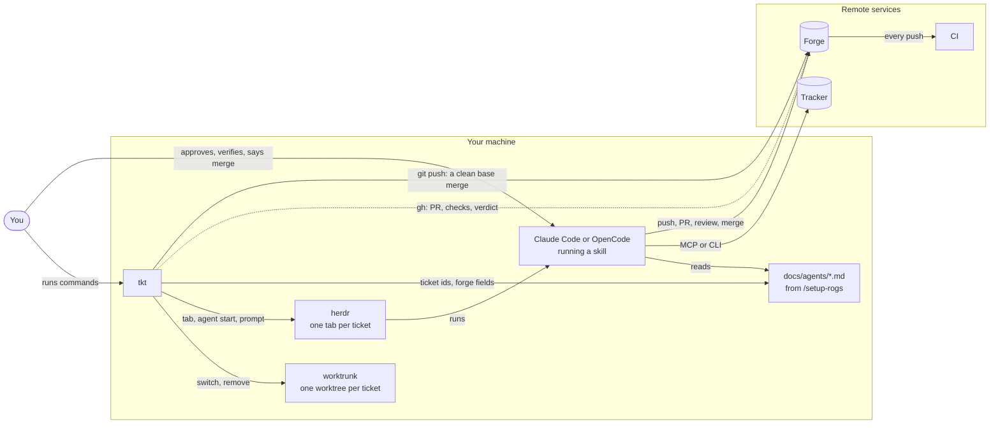
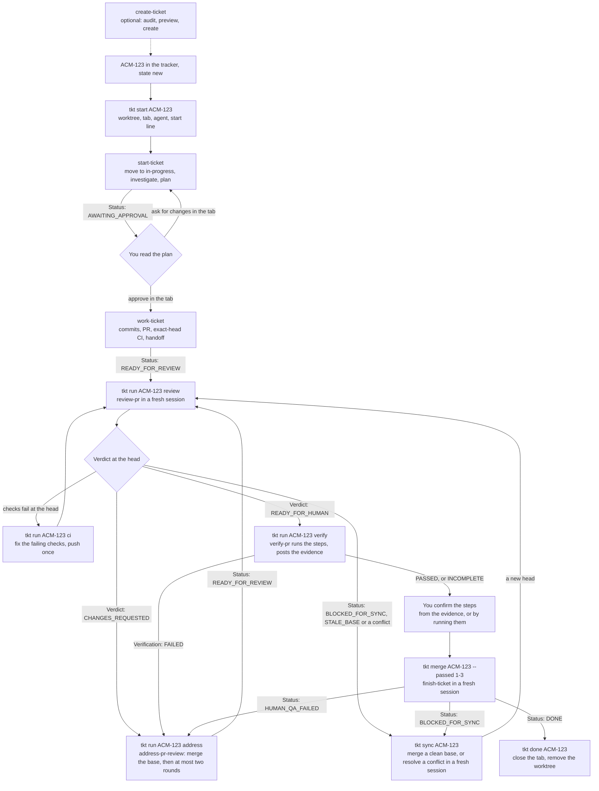
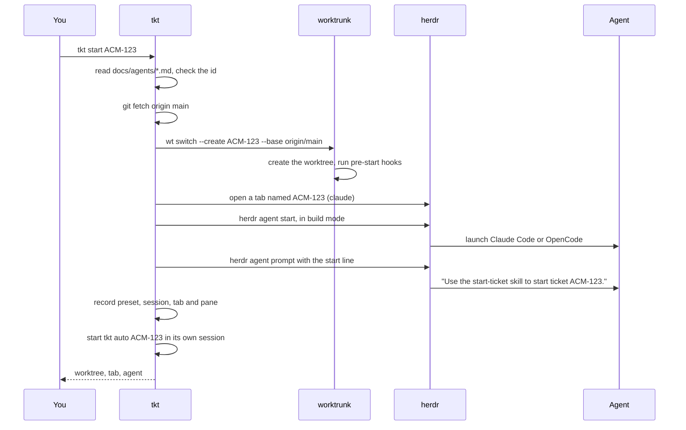
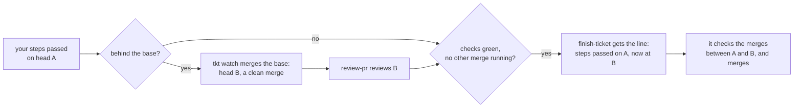
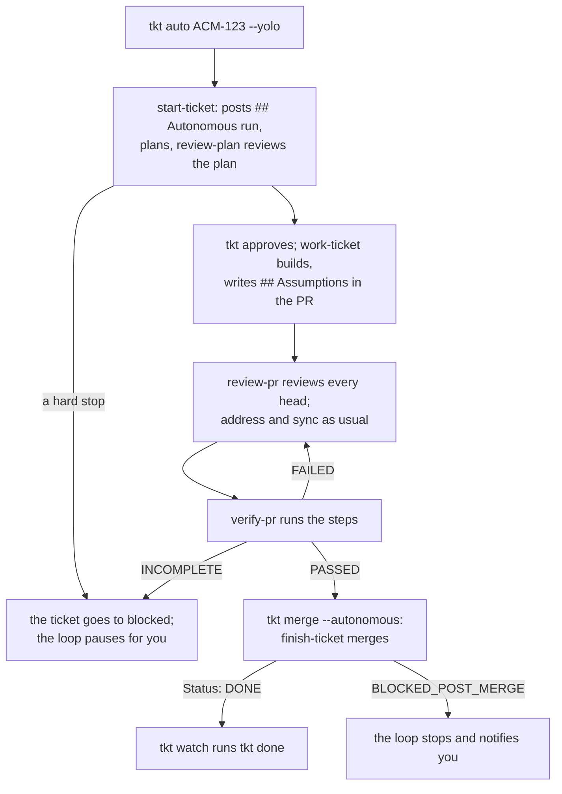
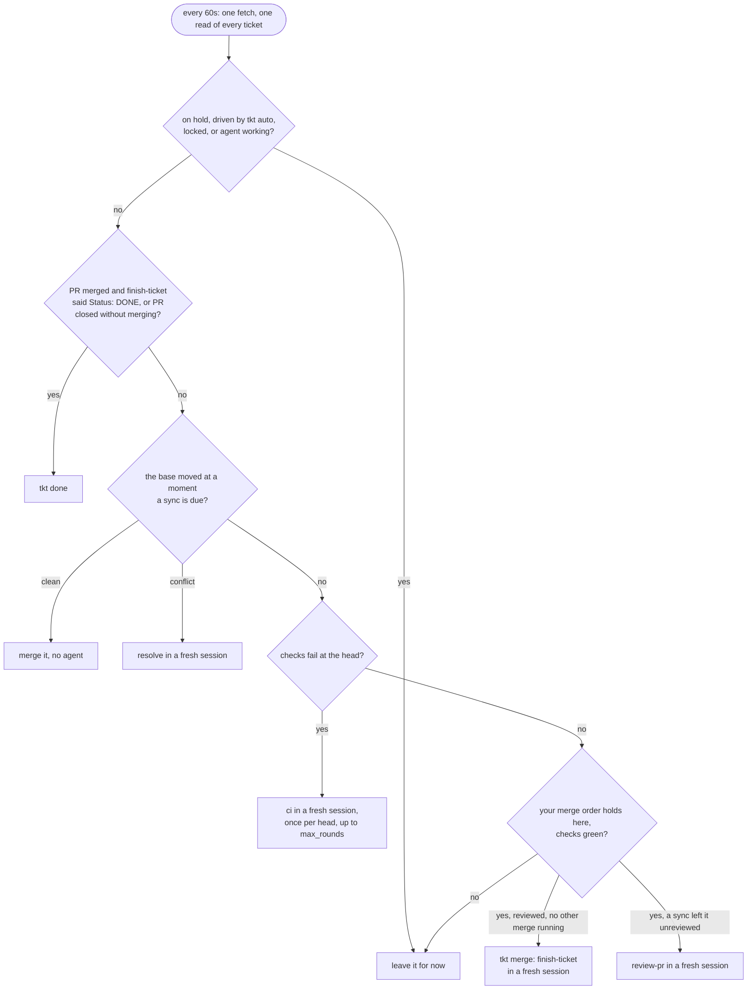
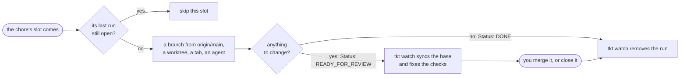
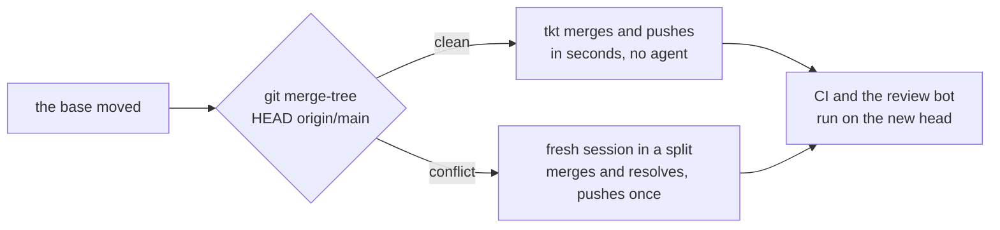
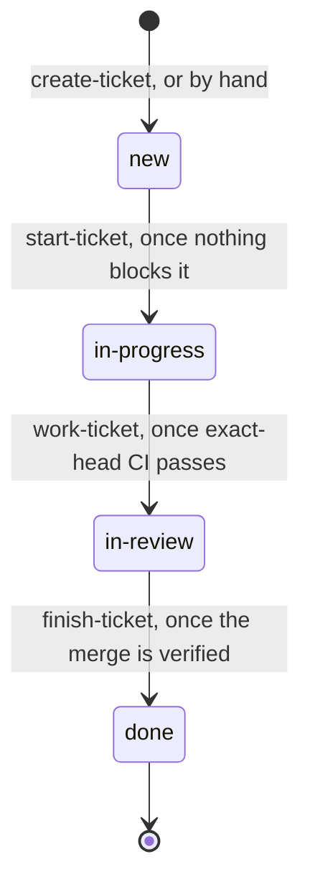

# The ticket lifecycle

This page follows one ticket, `ACM-123`, from the tracker to a merged pull request. It shows which tool does each step, which [rogs-skills](https://gitlab.com/rogs/skills) skill runs, what tkt does around it, and which line tells you a step is over. `tkt help lifecycle` has the short version for the terminal, and [`day-in-the-life.md`](day-in-the-life.md) follows a whole day with several tickets at once, mostly in the tkt agent's chat.

## The parts

| Part | What it does here |
|---|---|
| The tracker | Holds the ticket: Linear, Jira, GitHub Issues, Kaneo, local markdown files, or anything else `/setup-rogs` can describe. The skills read and write it through its MCP server or CLI. tkt never talks to it. |
| The forge | Holds the branch and the pull request: GitHub, Gitea or GitLab. The skills drive it through `gh`, `tea` or `glab`. tkt reads it through `gh`, so `tkt ls` and `tkt done` support GitHub only, and pushes one thing to it: a base merge that merges clean. |
| CI | Runs the checks on every push. Every claim that CI is green names the exact head it ran on. |
| The skills | Do the thinking: plan, implement, review, fix, merge. Each one ends with a `Status:` line and never starts the next one. |
| `docs/agents/*.md` | The project's lifecycle configuration, written by `/setup-rogs`. The skills read all of it; tkt reads the ticket id pattern, the `## Forge` fields, and the rows of workflow.md's feature table that turn on agent verification and autonomous runs. |
| Claude Code or OpenCode | The harness that runs a skill. tkt calls the pair of harness and model a preset. |
| herdr | The terminal multiplexer. It holds one tab per ticket and knows whether each agent is working, blocked, idle or done. |
| worktrunk (`wt`) | Creates and removes worktrees, and runs their hooks. |
| tkt | Runs the mechanical steps between stages: worktrees, tabs, agent sessions, prompts, clean base merges and cleanup. `tkt watch` takes the upkeep steps for every ticket and starts the chores you schedule, and `tkt auto` chains all of them for a ticket you hand over. |
| You | Approve the plan (or let `tkt auto --auto-plan` approve it), confirm the human verification steps, by running them or from verify-pr's evidence, and merge. Or hand a ticket to `tkt auto --yolo`, which does all of it with nobody watching. |



tkt reads the forge through `gh`, the dotted line, and changes it in one way only: when a ticket's base moved and the merge is clean, `tkt sync` makes the merge commit and pushes it, with no agent (see [Syncing with the base](#syncing-with-the-base)). Everything else that changes the tracker or the forge happens inside an agent, under a skill's rules.

## Before the first ticket

Run `/setup-rogs` once in the repository and commit the files it writes to the base branch. Ticket worktrees branch from the base, so a configuration that only lives in your main checkout never reaches them. Then run `tkt doctor`: it checks git, herdr, worktrunk, the harnesses, `gh`, and the configuration.

worktrunk must name each worktree's directory after its branch. Every lifecycle skill checks that the branch, the directory name and the ticket id are the same string, and stops when they differ.

## The whole flow



Every arrow out of a stage is a status line or a verdict on the screen or the pull request. Every arrow into a stage is something you do: a tkt command or an answer in the tab. `tkt watch` takes the upkeep arrows for every ticket: it syncs a moved base, fixes failing checks once per head, and runs `tkt done` after the merge (see [tkt watch keeps the tickets moving](#tkt-watch-keeps-the-tickets-moving)). The other arrows move only when you take them, or when you hand the ticket to `tkt auto`, which takes the same steps for you and pauses where a person decides (see [Letting tkt auto drive](#letting-tkt-auto-drive)). `tkt ls` reads the same facts and prints the next step for each ticket, and `tkt wait ACM-123` blocks until the agent finishes or needs you.

## Step by step

### 1. The ticket exists

A ticket starts in the tracker, in the state the configuration maps to `new`, or in `blocked` while a ticket it waits on is open. You can write it by hand, or ask an agent in the main checkout to run `create-ticket`. That skill audits the code for work already done, searches the tracker for duplicates, shows a preview and waits with `Status: AWAITING_CREATE_APPROVAL`. Only after you approve does it create the tickets and their blocked-by relations, read them back, and end with `Status: TICKETS_CREATED`.

tkt plays no part here. It needs only the id.

To pick which ready tickets to start, run `tkt suggest 3`, or `/suggest 3` in the tkt agent. To narrow the picks, put your own words after it, such as `tkt suggest five tickets tagged feedback`: tkt sends them as suggest-tickets' request, which sets the count and narrows the candidates by a label, an area or a model. Either way, a fresh session in a suggest tab at the repository's root runs `suggest-tickets`, which only reads: it keeps the ready tickets whose blockers are all done, ranks them by how many tickets wait on each and then by priority, and drops one that would collide with work in flight, judged from the files each in-flight branch changes, or with another pick. With model routing on, a batch gets at most one heavy ticket. It lists what waits on you first, then the picks, each with the model it runs on when model routing is on, and what it left out and why.

tkt acts on none of the answer. It stays in the suggest tab: read it there, or with `tkt suggest --show`, which the web page's Suggest view shows as it comes, ask its agent about it, and start the tickets you want with `tkt start`, or `/start` in the tkt agent, adding `--as` for a ticket whose model another preset serves. `[suggest] as` in `config.toml` names a cheap preset for the run.

### 2. tkt start creates the workspace

```bash
tkt start ACM-123
```

To send a longer prompt, such as a start-ticket block with a `Model:` line, pipe it in: `xclip -selection clipboard -o | tkt start --prompt -`.



Then tkt start starts a `tkt auto` loop for the ticket, which outlives it, and `tkt watch` starts the loop again when it is gone, as after a reboot. In auto, the default, the loop waits at the plan for you: it never approves a plan itself. Once you approve it, in the plan viewer or with `tkt approve`, the loop drives the ticket until it is ready for human verification. `--manual` starts no loop, `--auto-plan` starts one that approves the plan too, and `--yolo` one that carries the ticket to the merge. `[start] mode = "manual"` in `config.toml` makes manual the default.

The new branch starts from the base on the remote: tkt fetches it first, so the plan starts from the code the base holds now, not from a local `main` that nobody pulled. When the fetch fails, it warns and starts from the local base.

The tab's `TMPDIR` is a private directory for the ticket, such as `/tmp/tkt-acme-app-ACM-123-123456`, so `mktemp`, Python, Node, Go and `gh` in two tickets' agents never write the same temporary file. Claude Code runs its tools in the tab, so its agents have it. OpenCode runs every agent's tools in its one background service instead, which the tab's environment never reaches: `tkt hook tmp --install` puts tkt's plugin into OpenCode, which gives each shell in a ticket's worktree that ticket's `TMPDIR`, and moves into the ticket's directory a new `/tmp` path, such as `/tmp/pr-body.md`, that a file tool names or a shell command uses unquoted. A path in quotes, as in a search or a message, stays as written. `tkt doctor` warns while it is missing.

tkt keeps the ticket's preset, session, tab and pane in the worktree's git directory, so the record disappears with the worktree. The prompt's `Model:` line, when it has one, picks the first preset that serves that model.

### 3. start-ticket plans

The agent checks that it sits in the right worktree, loads the ticket with every comment and relation, and looks for blockers among the tickets in flight. When something blocks the ticket, it moves the ticket to `blocked` with a comment that says why, and stops with `Status: BLOCKED`. Otherwise it moves the ticket to `in-progress`, so the board shows it started, and reads the code end to end. It writes no code. It returns a plan that opens with a plain overview and diagrams, maps every acceptance criterion to a step, and names the seams the tests will cover. When plan review is on, a model from another vendor reviews the plan through `review-plan` before you see it. When plan presentation is on, `present-plan` shows it in a browser.

The agent ends with `Status: AWAITING_APPROVAL`. When you drop the ticket instead of approving a plan, tell the agent, and it moves the ticket back.

### 4. You approve, and work-ticket builds

Read the plan with `tkt show ACM-123`, which prints the agent's last message from its session's record. Ask for changes with `tkt send ACM-123 "what to change"` until the plan is right, then approve it with `tkt approve ACM-123`. Both type into the planning session, as an answer in the tab would. Do not use `tkt run` here: it starts a fresh session, and the plan lives in this one. With plan presentation on, you can approve in the browser instead: the agent goes on by itself and prints `Status: PLAN_APPROVED`, and `tkt ls` reads that line, moves the ticket to the work stage, and shows it building. An agent that skips the line and goes straight into `work-ticket` counts the same: start-ticket starts it only after the approval. tkt's hooks, `tkt hook claude --install` for Claude Code and `tkt hook tmp --install` for OpenCode, tell tkt the moment the skill starts. The same session goes on with `work-ticket`:

1. It posts the plan as an `## Approved implementation plan` comment, after moving the ticket to `in-progress` if it is not there yet.
2. It implements the plan, test-first where the configuration says so, and commits each unit through `commit`.
3. It merges the base into the branch, runs the full check, and pushes. Nothing rebases or force-pushes.
4. With the browser pass on, it captures each visible acceptance criterion with `playwright-cli`.
5. It opens the pull request through `create-pr`, with a review brief and a numbered human verification procedure.
6. It waits for CI on the exact head and checks that the head contains the current base.
7. It moves the ticket to `in-review` and posts a handoff comment on it.

It ends with `Status: READY_FOR_REVIEW`.

### 5. review-pr reviews in a fresh session

```bash
tkt run ACM-123 review
```

`tkt run` closes the idle agent and starts a new session in the same pane, so the reviewer is never the session that wrote the change. The new session remembers nothing and needs nothing: it reads the branch, the pull request and the tracker.

`review-pr` refuses to review a stale head. When the checks are not green for the exact head, or the base moved past it, it posts nothing and ends with `Status: BLOCKED_FOR_SYNC`. Otherwise it reviews the whole diff against every acceptance criterion, tries to disprove each finding before posting, and posts one review. The summary names the reviewed head and base and carries one of two verdicts:

- `Verdict: CHANGES_REQUESTED`, ending with `Status: REVIEW_POSTED`;
- `Verdict: READY_FOR_HUMAN`, ending with `Status: READY_FOR_HUMAN`, with the final human verification procedure in the summary.

When the forge runs an automated reviewer in CI instead, it posts an `Automated review: CLEAR`, `FINDINGS` or `STALE_BASE` line, and tkt reads that the same way: the bot's `CLEAR` counts like `READY_FOR_HUMAN`, and the steps to verify are then the pull request's own Human verification section. A verdict counts only for the head it names, so after every push the ticket waits for a new review.

Where `docs/agents/workflow.md` turns `CI review` on, which `/setup-rogs` does when it finds such a reviewer, the bot stands in for review-pr all the way to the merge: finish-ticket merges on its `CLEAR` for the exact head, and tkt never starts review-pr, not for a merge order on a head a sync made, and not when the bot goes silent. Without the row, finish-ticket merges only on review-pr's verdict, so tkt watch has review-pr review a head only the bot cleared before it carries out a merge order.

### 6. The review loop

Act on the verdict, then review again:

| What you see | Run | What happens |
|---|---|---|
| `Verdict: CHANGES_REQUESTED`, or comments you left | `tkt run ACM-123 address` | `address-pr-review` first merges the base when it moved, resolving conflicts. Then it checks each finding, fixes the valid ones at their root cause, answers the rest with evidence, pushes, waits for CI and replies to every comment. It runs at most two rounds and never resolves a thread. |
| `Status: BLOCKED_FOR_SYNC` with the branch behind, the bot's `STALE_BASE`, or a conflict | `tkt sync ACM-123` | tkt merges the base itself when the merge is clean, and pushes it in seconds. On a conflict, a fresh session runs the `resolve` stage, which only merges and resolves. See [Syncing with the base](#syncing-with-the-base). |
| The checks fail at the head, with no review to address | `tkt run ACM-123 ci` | A fresh agent finds the cause, fixes it, and pushes once. An infrastructure failure gets a rerun instead of a code change. |

`address` ends with `Status: READY_FOR_REVIEW`, which leads back to step 5, and so does a sync, since its new head needs a review too. On a re-review, `review-pr` checks each earlier thread against the new head and resolves the ones that are fixed.

### 7. verify-pr runs the steps, and you confirm them

When the verdict is `READY_FOR_HUMAN`, or the bot's `CLEAR`, the numbered steps are next. `tkt show ACM-123 --steps` prints them from the review summary, or from the pull request's body after the bot.

```bash
tkt run ACM-123 verify
```

`verify-pr` runs them in a fresh session, as you would: it starts the app as `browser-pass.md` says, drives a page with `playwright-cli`, runs a step's commands otherwise, and runs the cleanup. It posts one comment-only review on the pull request: one line per step, `PASSED`, `FAILED` or `NOT RUN`, with a capture or the command's output, and a `Verification:` line. It changes no code and never writes to the tracker. A step that needs a person, such as one that sends a code to a real phone, or one that would change a staging environment or shared data, stays `NOT RUN`.

Where workflow.md's feature table turns on `Agent verification`, this is the next step `tkt ls` names, and `tkt auto` takes it for you. `[verify] as` in `config.toml` runs it on another preset, such as one from another vendor, so the verifier does not share the blind spots of the model that built the change.

| Report | Next |
|---|---|
| `Verification: FAILED` | `tkt run ACM-123 address`: address-pr-review answers each failed step as a finding. The fix gets a new review, and verify-pr runs again on the new head. |
| `Verification: PASSED` | You confirm the steps from its evidence, or run them yourself. |
| `Verification: INCOMPLETE` | You run the steps it could not. |

A report counts for the head it ran on, and across clean merges of the base after it, as your confirmations do; a fix voids it. You still decide whether each step passed: verify-pr's report is evidence, not your word. `/check` in the tkt agent shows what it saw beside each step. The checklist starts with nothing marked, or with the marks you left on this head, since only you mark a step.

### 8. finish-ticket merges

`finish-ticket` merges only on your explicit word, so no stage line sends it. Once every step passed, `tkt merge ACM-123 --passed 1-3` sends that word for you, to a fresh session in the ticket's tab:

```
Use the finish-ticket skill to merge the PR. Human verification steps 1 to 3 passed on head 3f2a....
```

`--passed all` names every step, and `/check` in the tkt agent runs it when you mark the last one passed. First, `/check` runs `tkt verified ACM-123 --passed all --head 3f2a...`, which comments `Human verification passed` with a green check mark on the pull request, naming the steps and the head, once per head. The comment holds no status or verdict line, so the skills read past it. When you confirmed the steps from verify-pr's evidence instead of running them, add `--evidence`: the line then says `... passed on head 3f2a...: the user confirmed them from verify-pr's evidence.`, and finish-ticket checks that the report for that head marks each step `PASSED` and ran the final review's procedure. tkt merge checks the report first, and refuses with `not_verified` when it is missing or marks a step otherwise. Before any session starts, tkt merge refuses a list that leaves a step out, a head the steps cannot carry to (`--head`), a head no review cleared that no sync made, a base whose merge conflicts, and failing checks at a head it would merge as it is; `finish-ticket` checks the rest itself. When finish-ticket could not merge yet, tkt merge leaves a merge order instead, and `tkt watch` carries it out:



The steps carry over clean merges of the base: finish-ticket counts a confirmation given on an earlier head when every commit after it is a merge commit whose tree equals what `git merge-tree` gives for its two parents, the merge `tkt sync` makes, and it checks each one itself. finish-ticket merges on review-pr's `READY_FOR_HUMAN` at the head it merges, so a sync brings a fresh review-pr review, and so does a head only the review bot cleared; `tkt watch` starts it. One merge goes at a time, since a second finish-ticket that checks the base before the first one merges would merge an integration nobody reviewed. So you can verify three tickets, leave three orders, and walk away: each one syncs, gets its review and merges after the one before it.

The order stands until the pull request merges: when finish-ticket stops with `BLOCKED_FOR_SYNC` because another merge moved the base, `tkt watch` syncs again and sends the line on the new head. A new head of any other kind, a fix or the resolution of a conflict, drops the order with a notification, since the steps ran on code it changed; so does finish-ticket's `HUMAN_QA_FAILED`, and another session taking the ticket over after the line went out. `tkt merge ACM-123 --cancel` drops an order, and says when the line went out. To waive a step, or to merge after a step failed, tell the agent in the tab yourself.

Before it merges, `finish-ticket` requires green CI for the exact head, a `READY_FOR_HUMAN` verdict for that same head and base, no open feedback, and your confirmation of every human step. It then merges, checks that the merge commit's tree equals the reviewed head's, moves the ticket to `done`, waits for post-merge CI, and posts a `## Completion` comment.

| Ending | Next |
|---|---|
| `Status: DONE` | Step 9. |
| `Status: HUMAN_QA_FAILED` | A step failed. The agent records what you saw on the pull request; run `tkt run ACM-123 address`. |
| `Status: BLOCKED_FOR_SYNC` | The base moved after the review. Even a clean merge would ship an integration nobody reviewed, so the new head needs a review. Your merge order stands: `tkt watch` syncs, has the new head reviewed, and sends the line again, and your steps carry over the clean merge. |
| `Status: BLOCKED_POST_MERGE` | The merge landed but post-merge CI failed. The ticket is `done`, since its change merged, but has no `## Completion` comment yet; look at the base branch's checks. |

### 9. tkt done cleans up

```bash
tkt done ACM-123
```

`tkt watch` runs it for you once `finish-ticket` ends with `Status: DONE`; otherwise, run it from another tab. It confirms through `gh` that the pull request merged, closes the ticket's tabs, removes the worktree through `wt remove`, and removes the ticket's temporary directory. It keeps the worktree, and says why, when the worktree has uncommitted changes, the branch tip is neither the merged head nor in the base, or an agent still works there. `tkt done --all` checks every ticket worktree at once. It also records the merge in tkt's history, so `tkt stats` can tell how long the ticket took from `tkt start` to the merge, and how much of that it waited for you.

`finish-ticket` ends its report with the tickets the merge unblocked, the ones whose blockers are all done now, right before `Status: DONE`:

```
Unblocked: ACM-124, ACM-125
Status: DONE
```

`tkt done` reads that line from the ticket's session before it closes the tabs, and names the tickets, with no extra agent run. `tkt ls` lists each one until it starts, and the tkt agent's board offers to start it by hand, in auto, or in auto after you approve its plan.

## Letting tkt auto drive

`tkt auto ACM-123` takes the steps above for one ticket and pauses where a person decides. It reads the same facts as `tkt ls`, so it does nothing you could not do by hand:

| The ticket | tkt auto |
|---|---|
| Has no worktree yet | Runs `tkt start`. With `--auto-plan`, the start line says the run is unattended: start-ticket skips the browser plan presentation and asks every open question with the harness's question tool, so no decision hides in a plan nobody reads. |
| The agent works, or waits on its own background task such as a CI watcher | Waits for it. |
| `Status: AWAITING_APPROVAL` | Runs `tkt approve` with `--auto-plan`; without it, pauses for you. |
| Checks pending | Waits for CI. |
| A new head with green CI and no review | Waits for the review bot in CI. |
| Bot `STALE_BASE`, a conflict, or `BLOCKED_FOR_SYNC` behind the base | Syncs: when `git merge-tree` finds the merge clean, it merges and pushes it as `tkt sync` does, with no agent and no fix round; on a conflict it runs `tkt run ACM-123 resolve`. |
| Bot `FINDINGS`, or `Verdict: CHANGES_REQUESTED` | Runs `tkt run ACM-123 address`, which merges the base first. |
| Checks fail | Runs `tkt run ACM-123 ci`. |
| Bot `CLEAR`, or `Verdict: READY_FOR_HUMAN` at the head, with agent verification on | Runs `tkt run ACM-123 verify`, which spends no fix round. |
| verify-pr's `Verification: FAILED` | Runs `tkt run ACM-123 address`, a fix round. |
| Bot `CLEAR`, or `Verdict: READY_FOR_HUMAN` at the head, and verify-pr passed every step or could not run some, or agent verification is off | Stops: the ticket is yours to confirm and merge. |
| No bot review after `[review] bot_wait` (15 minutes) | Pauses for you, and with `CI review` on it never offers review-pr instead. With no bot (`bot_wait = "0s"`) it runs `tkt run ACM-123 review` instead. |
| A status page reports an incident (see [tkt watch keeps the tickets moving](#tkt-watch-keeps-the-tickets-moving)) | Waits: it starts, approves and runs nothing, and spends no round, until the incident ends. A sync goes on. |

Where a person decides, it pauses rather than ends: when the agent asks a question or ends with `Status: BLOCKED`, when no agent runs, after `[auto] max_rounds` fix runs (5), and when a step would repeat on the same head with nothing changed. It notifies once, shows the ticket as paused, and goes on by itself when the ticket moves, such as after you answer the agent in its tab. While it drives a ticket, the tab reads `ACM-123 (claude, auto)`. After `tkt update`, a loop restarts on the new tkt at its next look, once its agent stops working, and keeps the pause it notified about. `tkt hold ACM-123` pauses the loop until `tkt hold ACM-123 --off`, without a notification, for a ticket you want to park or drive by hand. At most `[auto] max_parallel` tkt auto agents (3) work at once in a repository; a loop gives up its slot while it waits for CI, the bot or you, and the others wait, queued.

## Yolo: a ticket nobody watches

`tkt auto ACM-123 --yolo` takes every step above, the merge too, with nobody watching. It is for a repository and a ticket where a wrong merge costs little: no person checks anything before it merges.

It runs only where workflow.md's feature table turns on `Autonomous runs`, `Agent verification` and `Plan review`, and refuses with `autonomous_off` elsewhere, naming the rows that are off. `/setup-rogs` writes the rows, and an `## Autonomous runs` section with the repository's hard stops, such as migrations, payments or a new dependency.



- Every line tkt sends a yolo ticket's agents, from the start line to the merge line and the stages `tkt watch` runs, ends with `This run is autonomous: no person reads this session or answers a question. Follow Autonomous runs in docs/agents/workflow.md wherever you would ask.` The skills then decide what they would ask you, on the most conservative reading the ticket, the code and the recorded decisions support, and write each decision under `## Assumptions` in the plan and in the pull request.
- start-ticket posts an `## Autonomous run` comment on the ticket, which finish-ticket requires before it merges on the request, so a ticket you started by hand never merges this way.
- review-plan, a model from another vendor, reviews the plan in place of you; a plan review that fails stops the run.
- At a hard stop, the skill moves the ticket to `blocked` with a comment naming the decision a person has to make, and the loop pauses for you.
- review-pr reviews every head, even one the review bot cleared, since finish-ticket merges on its verdict alone. Then verify-pr runs.
- Once verify-pr passed every step, `tkt merge ACM-123 --autonomous` sends finish-ticket `Use the finish-ticket skill to merge the PR. This run is autonomous: ... verify-pr passed every human verification step on head 3f2a....` finish-ticket counts each step as waived on that report, keeps every other gate (green CI at the exact head, review-pr's verdict at the same head and base, no open feedback, an unmoved base), checks the hard stops once more, and records that no person verified the change.
- Merges still go one at a time in the repository, through the same turn as `tkt merge`.
- Steps verify-pr could not run pause the loop: a yolo ticket merges only when every step passed.
- When the checks on the base fail after the merge, finish-ticket ends with `Status: BLOCKED_POST_MERGE`, and the loop stops with `post_merge_failed` and a notification. Nothing else happens; `tkt watch` leaves the ticket for you.
- A base branch whose protection requires a person's approval cannot merge this way: finish-ticket never merges with administrator rights.

A yolo run starts with the ticket: `--yolo` refuses a ticket you started another way, which has no `## Autonomous run` comment. The ticket stays a yolo one, and every stage line tkt sends it says so, until `tkt auto ACM-123 --stop` hands it back to you and drops any merge order the loop left. A merge line you send yourself, such as after the loop paused on steps verify-pr could not run, never says the run is autonomous, so finish-ticket takes your word. tkt merge refuses to merge over verify-pr's report of a failed step, since finish-ticket merges no head with open feedback. `tkt ls` shows `auto.yolo`, the AUTO column reads `yolo` while the loop drives it, and the tkt agent's board marks it.

`tkt agent` opens a chat that does all of this for many tickets at once: you say "start ACM-123 in auto", get the prompt back, and hear from it only when a ticket needs you. `tkt web`, or `/web` in the chat, opens the same chat in a browser, mirrored both ways: what you type in either place, and your answers to its questions, count in both. Beside the chat, the page shows what needs you with its answers as buttons, and each ticket's plan, pull request, verification steps, diff, live screen and history; every button sends the slash command you could type. `tkt show ACM-123 --diff` prints the same diff in a terminal.

## tkt watch keeps the tickets moving

`tkt watch` runs one per repository and keeps every ticket moving, not only the ones you hand to `tkt auto`. Every `[watch] interval` (60 seconds) it fetches once and reads every ticket with a fixed number of `gh` calls, however many there are. Then it takes at most one step per ticket:



Plans, findings and human verification stay with you, or with `tkt auto`, and so do reviews and the word to merge: watch merges only through the merge order `tkt merge` leaves when you verified a head finish-ticket could not merge yet, and it reviews only the head a sync made for such an order. A step watch would repeat on the same head, or a fix run past `[auto] max_rounds`, waits for you instead: the ticket shows as `needs_you`, and herdr notifies once. Its agent runs take the same `[auto] max_parallel` slots as `tkt auto`'s, and every step goes into the history.

While a status page that `config.toml` or the repository's `.tkt` files name reports a problem, such as a GitHub Actions outage or a model provider's, `tkt watch` starts no agent: no `ci`, `resolve` or `review` run, no merge line and no chore run, since each would only spend a round on a service that is down. Syncs and removals, which need no agent, go on, and `tkt auto` loops wait the same way. It reads the pages every five minutes, notifies when an incident starts and when it ends, and `tkt ls` and the tkt agent's board show it while it lasts:

```toml
[status.github]
page = "https://www.githubstatus.com"
components = ["Actions", "Pull Requests", "Git Operations"]
```

You rarely start it yourself: every tkt command in a herdr pane starts one when none runs for the repository, in a session of its own, so it outlives the command and the pane. `[watch] autostart = false`, or `TKT_WATCH=off`, turns that off; `tkt watch --stop` stops it, after the step it is taking; `tkt watch --once --dry-run` says what one pass would do to each ticket. Outside a herdr pane, it finds the workspace whose panes work in the repository, or opens one there before its first step when none has a pane; while herdr is down it waits. `tkt hold ACM-123` keeps it, and `tkt auto`, away from a ticket.

`tkt watch --install` keeps it running while no terminal is open: it makes `tkt watch` and herdr's server systemd user units, or launchd agents on macOS, that start at boot, with the `PATH` of the shell you ran it from. On Linux that takes `loginctl enable-linger`, which it asks about: without it, systemd stops the units when your last session ends, so herdr's stays off. Every tkt command then starts the unit rather than a watch of its own, and `tkt watch --stop` stops the unit. `tkt doctor` checks that both run and that their `PATH` finds the harnesses.

## Chores

A chore is an agent run you schedule in the repository's `.tkt/tkt.local.toml`, your own file in its main checkout, such as a dependency upgrade twice a week. It has no ticket: each run is a branch and a pull request.



The repository's `tkt watch` starts a run when its slot comes, once per slot, however many passed while no watch ran; the first watch to see a chore starts its first run at the next slot. `tkt chore run deps` starts one now. Each run gets a branch from the base on the remote, named by the chore's `branch` setting, such as `deps-2026-10-26`, and never an older run's branch. Its agent gets the chore's prompt and one rule from tkt: commit on the run's branch, push it, open one pull request to the base, and end with `Status: READY_FOR_REVIEW`, or with `Status: DONE` and nothing pushed when there is nothing to change.

From there the pull request moves as a ticket's does, short of what needs a ticket. `tkt watch` syncs its base when a sync is due and runs `ci` once per head when its checks fail. review-pr, address-pr-review and finish-ticket each start from a ticket, so none of them takes a chore's pull request: the review bot in CI reviews it, `tkt ls` says when the review found something and when the pull request is ready, and you merge it yourself, or close it to drop the run. `tkt watch` then removes the run, as `tkt done` would. A slot that comes while the last run is still open is skipped, so one run waits for you at a time. A run whose start stopped before its agent got the prompt, as on a pre-start hook that failed, waits for you too: `tkt chore run deps` goes on with it.

## Syncing with the base

When another ticket merges, the base moves, and the branches still open fall behind it. `tkt sync ACM-123` brings one up to date:



`git merge-tree` tests the merge in memory, without touching the worktree or the branch. A clean merge becomes a merge commit and a normal push; tkt never rebases and never force-pushes, and when the push fails it undoes its merge and hands the failure to the `sync-fix` stage, whose line says why and names the log of git's output. A conflict goes to the `resolve` stage, which merges the base, resolves each conflict from what both sides meant, changes nothing else, refreshes the pull request's review brief when it has one, and pushes once. Review findings stay for `address`.

Both fixes run in a split beside the ticket's agent, which keeps its pane and its conversation, and so does a `ci` run for failing checks. `[fixes] as` runs them on a cheaper preset. The split closes once the fix ends with `Status: READY_FOR_REVIEW` and `tkt watch` or `tkt auto` looks again; a fix that stops otherwise keeps its split, and the board says so.

When a sync fails after its fetch, as when a pre-push hook refuses the push, tkt keeps why: `tkt ls --json` shows the reason under the row's `sync` while the head is the one it failed on, `tkt history` lists it, and a log in the ticket's temporary directory holds everything git and its hooks printed. The tkt agent's chat reads it from there when you ask why a sync failed.

A clean merge does not make the pull request's review brief stale: the merge commit's tree equals what `git merge-tree` gives for its two parents, and review-pr checks that for itself instead of trusting tkt.

A sync costs a CI run and a review, so tkt syncs a ticket that is behind only at the moments that need it:

| Moment | How tkt knows | Why it can't wait |
|---|---|---|
| The branch conflicts | The forge reports the pull request as conflicting, or `git merge-tree` finds a conflict | Nothing merges, and conflicts only grow. |
| A review can't happen | The bot posts `STALE_BASE`, or review-pr stops with `BLOCKED_FOR_SYNC` | review-pr reviews only a head that contains the current base. |
| You are about to verify | You open `/check` in the tkt agent on a ticket that is behind | `/check` offers to sync first, so your steps run on the code that will merge; verify the head as it is, and the steps carry over the sync your merge order gets. |
| A merge is due | A merge order on a ticket that is behind, or finish-ticket stops with `BLOCKED_FOR_SYNC` | finish-ticket merges only a head reviewed against the current base; the steps you verified carry over the clean merge. |

A ticket without a pull request waits, since work-ticket merges the base itself right before it pushes, and so does a reviewed ticket that nobody verifies or merges yet. With five tickets in flight, syncing every branch whenever the base moves would cost four CI runs and four reviews per merge; at these moments a merge costs a sync only for the tickets that reach one, usually the next one you merge.

## Who changes the tracker

Each skill moves a ticket as soon as its new state is true, so the board stays current:



work-ticket also moves a ticket that is still `new` before its first edit, and start-ticket moves the ticket back when you drop it instead of approving a plan.

A ticket that waits on a blocker sits in `blocked`, with a `## Blocked` comment that says why. create-ticket creates a ticket there while a ticket it waits on is open, and start-ticket, work-ticket and address-pr-review move one there when they stop on a blocker. It goes back to the state it had, with an `## Unblocked` comment, when finish-ticket merges its last blocker, or when the next run on it finds its blockers cleared. When the tracker has no blocked state, the ticket keeps its state, and only the comment shows the block.

`review-pr` and `verify-pr` never write to the tracker. `address-pr-review` writes only replacement browser captures and the blocked moves. In a yolo run, start-ticket also posts the `## Autonomous run` comment. tkt never touches the tracker at all.

## The rules that hold it together

- One ticket, one branch, one worktree, one tab, all named `ACM-123`. A chore's run is the same, named after its branch.
- The implementer never reviews its own change. `tkt run` always starts a fresh session, which makes that easy.
- The fixer never resolves review threads; the next review does.
- Only `finish-ticket` merges, and only when you say so: with your merge line, or when you started the ticket with `tkt auto --yolo`.
- An agent's verification is evidence, never your word. Only in a yolo run does finish-ticket count verify-pr's passing report in place of your confirmation.
- Every claim that CI passed, the change was reviewed, or the steps were verified names the exact head, and that head contains the current base.
- Branches take the base by merging it. Nothing rebases or force-pushes a published branch, `tkt sync` included.
- The skills never start one another. tkt suggests the next step in `tkt ls`; you run it, `tkt watch` runs the upkeep steps, or `tkt auto` runs it for a ticket you hand over. Neither merges a pull request on its own word: `tkt watch` carries out the merge order you left, and `tkt auto` merges only a ticket you started with `--yolo`.

## When something stops

| You see | Do |
|---|---|
| `Status: SETUP_REQUIRED` | Run `/setup-rogs` and commit its files to the base. |
| `Status: BLOCKED` with a `Reason:` line | Read the reason in the tab. It names what a person has to decide or fix. When a blocker holds the ticket, the tracker shows it in `blocked`, with the reason in a comment. |
| The agent waits for an answer | Answer it in the tab. `tkt ls` shows it as blocked. |
| No agent runs for the ticket | `tkt resume ACM-123` brings back the last session and sends nothing. Use it, not `tkt run`, when the conversation matters, such as a plan waiting for approval. |
| The pull request closed without merging | Closing it rejected the work. `tkt watch` removes the ticket's tabs and worktree once no agent works there, as `tkt done ACM-123` does, and keeps a worktree with commits that never reached the pull request. tkt never writes the tracker, so move the ticket there yourself. |

`tkt ls` applies these rules in order and prints the next step. `tkt help ls` lists the rules.
