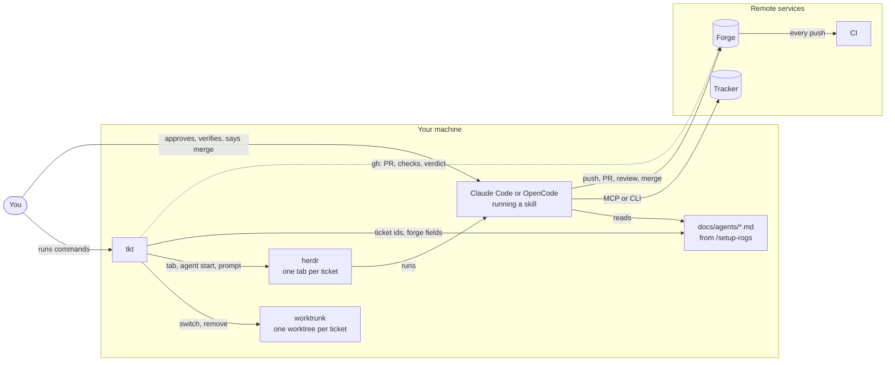
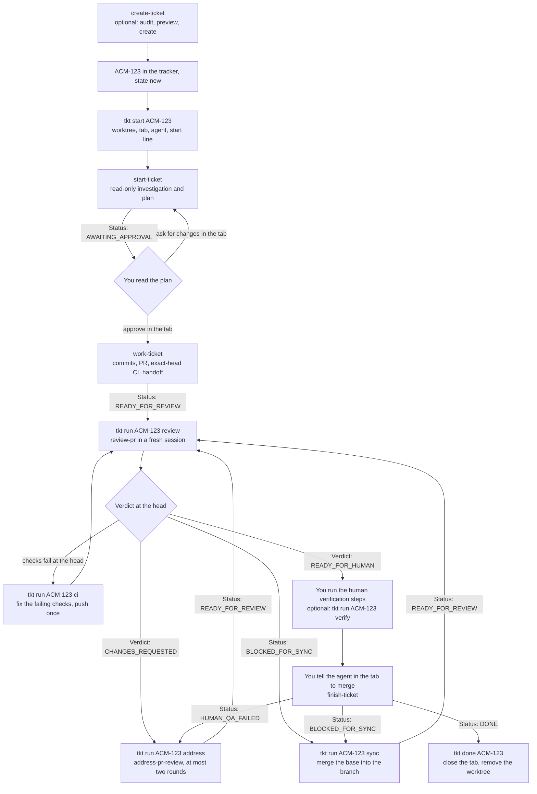
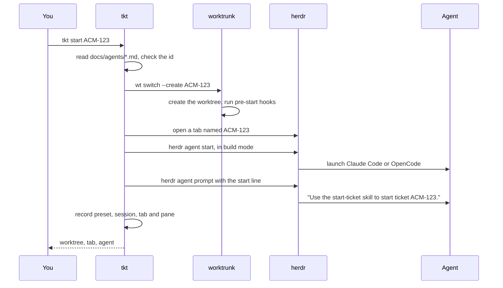
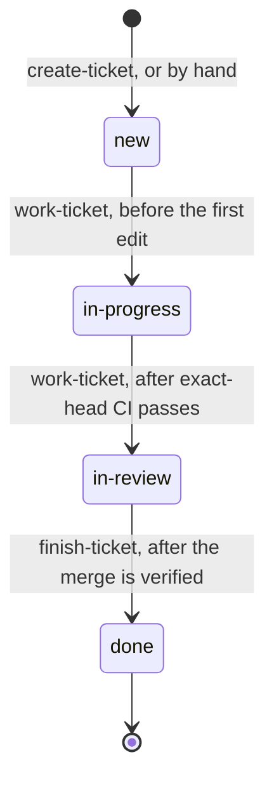

# The ticket lifecycle

This page follows one ticket, `ACM-123`, from the tracker to a merged pull request. It shows which tool does each step, which [rogs-skills](https://gitlab.com/rogs/skills) skill runs, what tkt does around it, and which line tells you a step is over. `tkt help lifecycle` has the short version for the terminal.

## The parts

| Part | What it does here |
|---|---|
| The tracker | Holds the ticket: Linear, Jira, GitHub Issues, Kaneo, local markdown files, or anything else `/setup-rogs` can describe. The skills read and write it through its MCP server or CLI. tkt never talks to it. |
| The forge | Holds the branch and the pull request: GitHub, Gitea or GitLab. The skills drive it through `gh`, `tea` or `glab`. tkt reads it through `gh`, so `tkt ls` and `tkt done` support GitHub only. |
| CI | Runs the checks on every push. Every claim that CI is green names the exact head it ran on. |
| The skills | Do the thinking: plan, implement, review, fix, merge. Each one ends with a `Status:` line and never starts the next one. |
| `docs/agents/*.md` | The project's lifecycle configuration, written by `/setup-rogs`. The skills read all of it; tkt reads the ticket id pattern and the `## Forge` fields. |
| Claude Code or OpenCode | The harness that runs a skill. tkt calls the pair of harness and model a preset. |
| herdr | The terminal multiplexer. It holds one tab per ticket and knows whether each agent is working, blocked, idle or done. |
| worktrunk (`wt`) | Creates and removes worktrees, and runs their hooks. |
| tkt | Runs the mechanical steps between stages: worktrees, tabs, agent sessions, prompts and cleanup. `tkt auto` chains them for a ticket you hand over. |
| You | Approve the plan (or let `tkt auto --approve-plan` approve it), run the human verification steps, and merge. |



The dotted line is the only remote call tkt makes. Everything that changes the tracker or the forge happens inside an agent, under a skill's rules.

## Before the first ticket

Run `/setup-rogs` once in the repository and commit the files it writes to the base branch. Ticket worktrees branch from the base, so a configuration that only lives in your main checkout never reaches them. Then run `tkt doctor`: it checks git, herdr, worktrunk, the harnesses, `gh`, and the configuration.

worktrunk must name each worktree's directory after its branch. Every lifecycle skill checks that the branch, the directory name and the ticket id are the same string, and stops when they differ.

## The whole flow



Every arrow out of a stage is a status line or a verdict on the screen or the pull request. Every arrow into a stage is something you do: a tkt command or an answer in the tab. Nothing moves on its own unless you hand the ticket to `tkt auto`, which takes the same steps for you and stops where a person decides (see [Letting tkt auto drive](#letting-tkt-auto-drive)). `tkt ls` reads the same facts and prints the next step for each ticket, and `tkt wait ACM-123` blocks until the agent finishes or needs you.

## Step by step

### 1. The ticket exists

A ticket starts in the tracker, in the state the configuration maps to `new`. You can write it by hand, or ask an agent in the main checkout to run `create-ticket`. That skill audits the code for work already done, searches the tracker for duplicates, shows a preview and waits with `Status: AWAITING_CREATE_APPROVAL`. Only after you approve does it create the tickets and their blocked-by relations, read them back, and end with `Status: TICKETS_CREATED`.

tkt plays no part here. It needs only the id.

### 2. tkt start creates the workspace

```bash
tkt start ACM-123
```

To send a longer prompt, such as a start-ticket block with a `Model:` line, pipe it in: `xclip -selection clipboard -o | tkt start --prompt -`.



tkt keeps the ticket's preset, session, tab and pane in the worktree's git directory, so the record disappears with the worktree. The prompt's `Model:` line, when it has one, picks the first preset that serves that model.

### 3. start-ticket plans

The agent checks that it sits in the right worktree, loads the ticket with every comment and relation, looks for blockers among the tickets in flight, and reads the code end to end. It writes no code. It returns a plan that opens with a plain overview and diagrams, maps every acceptance criterion to a step, and names the seams the tests will cover. When plan review is on, a model from another vendor reviews the plan through `review-plan` before you see it. When plan presentation is on, `present-plan` shows it in a browser.

The agent ends with `Status: AWAITING_APPROVAL`, and the tracker is unchanged.

### 4. You approve, and work-ticket builds

Read the plan with `tkt show ACM-123`, which prints the agent's last message from its session's record. Ask for changes with `tkt send ACM-123 "what to change"` until the plan is right, then approve it with `tkt approve ACM-123`. Both type into the planning session, as an answer in the tab would. Do not use `tkt run` here: it starts a fresh session, and the plan lives in this one. The same session goes on with `work-ticket`:

1. It posts the plan as an `## Approved implementation plan` comment and moves the ticket to `in-progress`.
2. It implements the plan, test-first where the configuration says so, and commits each unit through `commit`.
3. It merges the base into the branch, runs the full check, and pushes. Nothing rebases or force-pushes.
4. With the browser pass on, it captures each visible acceptance criterion with `playwright-cli`.
5. It opens the pull request through `create-pr`, with a review brief and a numbered human verification procedure.
6. It waits for CI on the exact head and checks that the head contains the current base.
7. It posts a handoff comment on the ticket and moves it to `in-review`.

It ends with `Status: READY_FOR_REVIEW`.

### 5. review-pr reviews in a fresh session

```bash
tkt run ACM-123 review
```

`tkt run` closes the idle agent and starts a new session in the same pane, so the reviewer is never the session that wrote the change. The new session remembers nothing and needs nothing: it reads the branch, the pull request and the tracker.

`review-pr` refuses to review a stale head. When the checks are not green for the exact head, or the base moved past it, it posts nothing and ends with `Status: BLOCKED_FOR_SYNC`. Otherwise it reviews the whole diff against every acceptance criterion, tries to disprove each finding before posting, and posts one review. The summary names the reviewed head and base and carries one of two verdicts:

- `Verdict: CHANGES_REQUESTED`, ending with `Status: REVIEW_POSTED`;
- `Verdict: READY_FOR_HUMAN`, ending with `Status: READY_FOR_HUMAN`, with the final human verification procedure in the summary.

When the forge runs an automated reviewer instead, it posts an `Automated review: CLEAR`, `FINDINGS` or `STALE_BASE` line, and tkt reads that the same way. A verdict counts only for the head it names, so after every push the ticket waits for a new review.

### 6. The review loop

Act on the verdict, then review again:

| What you see | Run | What happens |
|---|---|---|
| `Verdict: CHANGES_REQUESTED`, or comments you left | `tkt run ACM-123 address` | `address-pr-review` checks each finding, fixes the valid ones at their root cause, answers the rest with evidence, pushes, waits for CI and replies to every comment. It runs at most two rounds and never resolves a thread. |
| `Status: BLOCKED_FOR_SYNC`, or the pull request conflicts | `tkt run ACM-123 sync` | `address-pr-review` merges the base into the branch, reruns the checks and refreshes the review brief. |
| The checks fail at the head, with no review to address | `tkt run ACM-123 ci` | A fresh agent finds the cause, fixes it, and pushes once. An infrastructure failure gets a rerun instead of a code change. |

`address` and `sync` both end with `Status: READY_FOR_REVIEW`, which leads back to step 5. On a re-review, `review-pr` checks each earlier thread against the new head and resolves the ones that are fixed.

### 7. You verify

When the verdict is `READY_FOR_HUMAN`, run the numbered steps in the review summary yourself; `tkt show ACM-123 --steps` prints them. `tkt run ACM-123 verify` can have an agent run them in a browser and report what it saw for each one. It changes no code and posts nothing, and you still decide whether each step passed.

### 8. finish-ticket merges

No stage line sends this, because `finish-ticket` merges only on your explicit word. In the tab, tell the agent which steps passed:

```
Merge the PR. Human verification steps 1 to 3 passed.
```

Before it merges, `finish-ticket` requires green CI for the exact head, a `READY_FOR_HUMAN` verdict for that same head and base, no open feedback, and your confirmation of every human step. It then merges, checks that the merge commit's tree equals the reviewed head's, waits for post-merge CI, posts a `## Completion` comment, and moves the ticket to `done`.

| Ending | Next |
|---|---|
| `Status: DONE` | Step 9. |
| `Status: HUMAN_QA_FAILED` | A step failed. The agent records what you saw on the pull request; run `tkt run ACM-123 address`. |
| `Status: BLOCKED_FOR_SYNC` | The base moved after the review. Even a clean merge would ship an integration nobody reviewed, so run `tkt run ACM-123 sync` and review again. |
| `Status: BLOCKED_POST_MERGE` | The merge landed but post-merge CI failed. The ticket stays in `in-review`; look at the base branch's checks. |

### 9. tkt done cleans up

```bash
tkt done ACM-123
```

Run it from another tab. It confirms through `gh` that the pull request merged, closes the ticket's tabs, and removes the worktree through `wt remove`. It keeps the worktree, and says why, when the worktree has uncommitted changes, the branch tip is neither the merged head nor in the base, or an agent still works there. `tkt done --all` checks every ticket worktree at once. It also records the merge in tkt's history, so `tkt stats` can tell how long the ticket took from `tkt start` to the merge, and how much of that it waited for you.

## Letting tkt auto drive

`tkt auto ACM-123` takes the steps above for one ticket and stops where a person decides. It reads the same facts as `tkt ls`, so it does nothing you could not do by hand:

| The ticket | tkt auto |
|---|---|
| Has no worktree yet | Runs `tkt start`. |
| The agent works | Waits for it. |
| `Status: AWAITING_APPROVAL` | Runs `tkt approve` with `--approve-plan`; without it, stops for you. |
| Checks pending | Waits for CI. |
| A new head with green CI and no review | Waits `[review] bot_wait` (15 minutes) for the review bot. |
| Bot `FINDINGS` or `Verdict: CHANGES_REQUESTED` | Runs `tkt run ACM-123 address`. |
| Bot `STALE_BASE`, a conflict, or `BLOCKED_FOR_SYNC` behind the base | Runs `tkt run ACM-123 sync`. |
| Checks fail | Runs `tkt run ACM-123 ci`. |
| Bot `CLEAR`, or no bot review in time | Runs `tkt run ACM-123 review`, because only review-pr gives `READY_FOR_HUMAN` and the human verification steps. |
| `Verdict: READY_FOR_HUMAN` at the head | Stops: the ticket is yours to verify and merge. |

It also stops, with exit 4 and `auto_stopped`, when the agent asks a question or ends with `Status: BLOCKED`, when no agent runs, after `[auto] max_rounds` fix runs (5), and when a step would repeat on the same head with nothing changed. At most `[auto] max_parallel` loops (3) run at once in a repository; the others wait, queued.

`tkt agent` opens a chat that does all of this for many tickets at once: you say "start ACM-123 in auto", get the prompt back, and hear from it only when a ticket needs you.

## Who changes the tracker

Only three skills move a ticket, and each moves it once:



`start-ticket` and `review-pr` never write to the tracker. `address-pr-review` writes only replacement browser captures. tkt never touches the tracker at all.

## The rules that hold it together

- One ticket, one branch, one worktree, one tab, all named `ACM-123`.
- The implementer never reviews its own change. `tkt run` always starts a fresh session, which makes that easy.
- The fixer never resolves review threads; the next review does.
- Only `finish-ticket` merges, and only when you say so.
- Every claim that CI passed, the change was reviewed, or the steps were verified names the exact head, and that head contains the current base.
- Branches take the base by merging it. Nothing rebases or force-pushes a published branch.
- The skills never start one another. tkt suggests the next step in `tkt ls`; you run it, or `tkt auto` runs it for a ticket you hand over. `tkt auto` never merges.

## When something stops

| You see | Do |
|---|---|
| `Status: SETUP_REQUIRED` | Run `/setup-rogs` and commit its files to the base. |
| `Status: BLOCKED` with a `Reason:` line | Read the reason in the tab. It names what a person has to decide or fix. |
| The agent waits for an answer | Answer it in the tab. `tkt ls` shows it as blocked. |
| No agent runs for the ticket | `tkt resume ACM-123` brings back the last session and sends nothing. Use it, not `tkt run`, when the conversation matters, such as a plan waiting for approval. |
| The pull request closed without merging | Decide by hand. tkt does not guess. |

`tkt ls` applies these rules in order and prints the next step. `tkt help ls` lists the rules.
